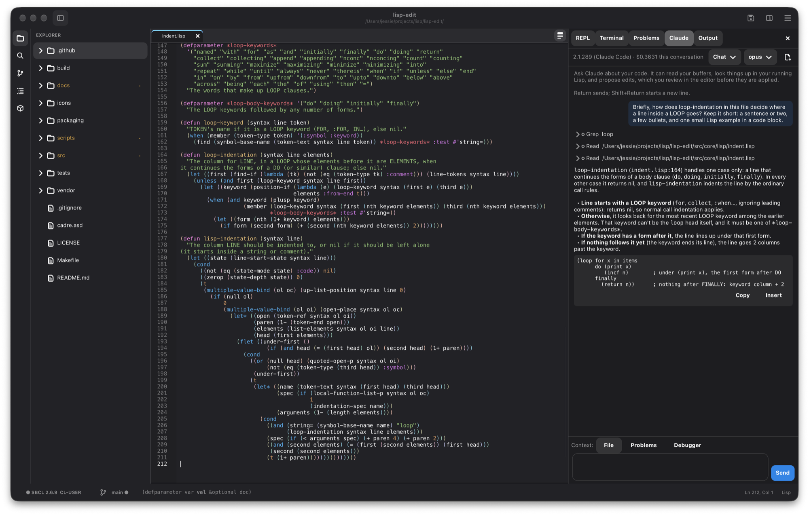
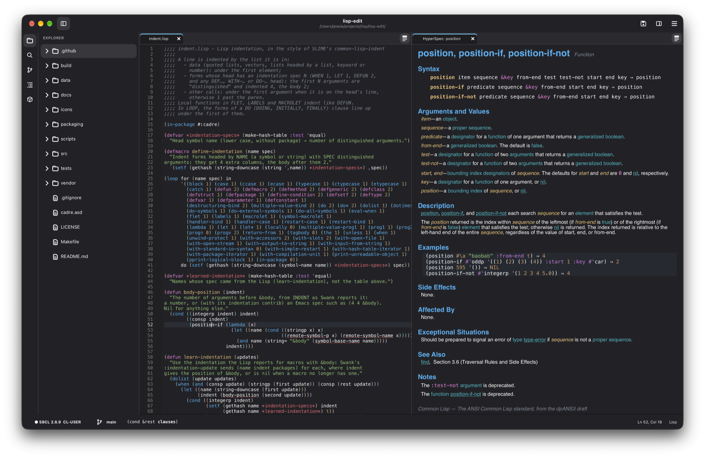
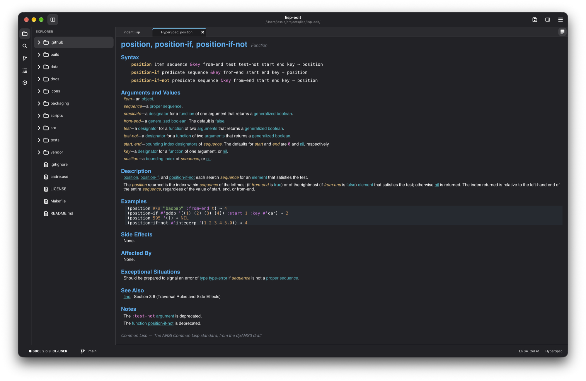

# Cadre

[](https://github.com/crazymevt/cadre-editor/actions/workflows/test.yml)

A Common Lisp editor, written in Common Lisp: Emacs's depth for Lisp, with an
interface like VS Code's. Built on the [gtk4](https://github.com/crazymevt/gtk4) bindings and libadwaita.



**Status:** version 1.0.0, for macOS and Linux ([CHANGELOG.md](CHANGELOG.md)),
editing Common Lisp, Racket and Clojure ([docs/RACKET-CLOJURE.md](docs/RACKET-CLOJURE.md)).
See [docs/DESIGN.md](docs/DESIGN.md) for the design and the milestones it was built in:

- **M0:** a window with a file explorer, tabs, an editor with line numbers, a
  panel (Output; REPL and Problems arrive in M2), a status bar, the horizontal
  and vertical layouts, opening and saving files, and two keybinding profiles
  (Standard and Emacs) on top of Cadre's command and keymap model.
- **M1:** syntax highlighting from Cadre's own Lisp lexer (re-lexing only the
  lines that change), rainbow parentheses, matching-paren and current-line
  highlighting, Lisp indentation, moving over s-expressions, a command
  palette, quick open, switching buffers, go to line, and a find bar.
- **M2:** a Swank client and a bundled Swank (SLIME 2.32): start a Lisp or
  connect to one, a REPL, evaluating and compiling forms and files, compiler
  notes (Problems page and underlines), argument hints in the status bar,
  completion, go to definition and back, describe, and a debugger page with
  restarts and the backtrace.
- **M3:** a full debugger (frame locals, evaluate in a frame, frame source,
  restart or return from a frame, more frames, inspect the condition), an
  inspector, cross-references (who calls, references, binds, sets, expands,
  specializes), a macroexpander, a Project view in the sidebar, and
  highlighting from the running image (user macros, special variables,
  constants, calls to undefined functions). Later: a Trace page (calls of
  traced functions as a tree) and a stepper.
- **M4:** Claude, through the Claude Code CLI: a Claude panel with streaming
  replies, context from the editor, tool calls shown as they happen, and
  approval prompts; an MCP server through which Claude reads your buffers and
  asks your running Lisp (describe, arglists, definitions, cross-references,
  macroexpansion, compiler notes, the backtrace); and edits proposed as inline
  diffs in the editor, which you accept or reject.
- **M5:** Emacs depth: structural editing and paredit mode, a kill ring
  shared with the system clipboard, the mark and mark ring, incremental
  search and query-replace (and replace in the find bar), keyboard macros,
  numeric arguments, help about keys and commands, split editors, session
  restore, and a REPL in Cadre's own image.
- **M6:** a settings page for every option, color themes (with a light and a
  dark choice), Claude's agent mode, and reloading files changed on disk.

## Installing a release

The [Releases](https://github.com/crazymevt/cadre-editor/releases) page has
packages with Cadre compiled in:

- **macOS** (Apple silicon, macOS 15 or newer): open the `.dmg` and drag
  Cadre to Applications. It carries its own GTK. It isn't signed by a
  registered developer yet, so macOS blocks it the first time: open System
  Settings → Privacy & Security and choose **Open Anyway** (or run `xattr -dr
  com.apple.quarantine /Applications/Cadre.app`).
- **Linux** (x86-64, with GTK 4.14+ and libadwaita 1.5+, as on Ubuntu 24.04
  or newer): install the `.deb` (`sudo apt install ./cadre_*.deb`), or unpack
  the `.tar.gz` anywhere and run `bin/cadre`.

For the REPL, install a Lisp (`brew install sbcl`, or `sudo apt install
sbcl`). The optional tools below (Git, Claude Code, Racket, the Clojure
CLI, tree-sitter, Prettier) are used when they're installed.

## Setup

To run Cadre from source, or build its packages. Cadre is developed on macOS
(Apple silicon, with Homebrew) and also runs on Linux.

### Required

| What | Version | Why |
| --- | --- | --- |
| [SBCL](https://www.sbcl.org) | 2.2.9 or newer (tested with 2.6.9) | Cadre runs in it, and it's the default Lisp for the REPL |
| [Quicklisp](https://www.quicklisp.org) | — | Fetches Cadre's Lisp libraries (cl-ppcre, cffi, alexandria; parachute for the tests) on the first run |
| GTK | 4.14 or newer | The interface |
| libadwaita | 1.5 or newer | Window styling, light and dark themes |
| The [gtk4 bindings](https://github.com/crazymevt/gtk4) | — | Checked out next to Cadre (`../gtk4`), or in `~/quicklisp/local-projects/` |
| The [docset library](https://github.com/crazymevt/docset) | — | Reads the documentation the HyperSpec tab shows. Checked out next to Cadre (`../docset`), or in `~/quicklisp/local-projects/` |

The gtk4 bindings and the docset library aren't in Quicklisp's dist, so you
check them out yourself (step 3).

On macOS:

1. Install the system libraries:

   ```sh
   brew install sbcl gtk4 libadwaita
   ```

2. Install Quicklisp, if you don't have it (from
   [its instructions](https://www.quicklisp.org/beta/#installation)):

   ```sh
   curl -O https://beta.quicklisp.org/quicklisp.lisp
   sbcl --load quicklisp.lisp --eval '(quicklisp-quickstart:install)' --eval '(ql:add-to-init-file)' --quit
   ```

3. Check out Cadre, the gtk4 bindings and the docset library side by side,
   and link the two libraries into Quicklisp's local projects:

   ```sh
   mkdir -p ~/projects/lisp && cd ~/projects/lisp
   git clone https://github.com/crazymevt/cadre-editor.git
   git clone https://github.com/crazymevt/gtk4.git
   git clone https://github.com/crazymevt/docset.git
   ln -s ~/projects/lisp/gtk4 ~/quicklisp/local-projects/gtk4
   ln -s ~/projects/lisp/docset ~/quicklisp/local-projects/docset
   cd cadre-editor
   ```

   Cadre's scripts find the libraries next to it on their own. The links let
   anything else load them: the REPL, your own GTK programs, and the
   `docsets` project below. If Quicklisp doesn't see a new link, run
   `(ql:register-local-projects)` once.

   Any folder works. Cadre itself needs only one of the two: the libraries
   side by side with it, or linked into Quicklisp's local projects.

4. Start Cadre with `make run`. The first run takes a minute or two, while
   Quicklisp downloads the libraries and SBCL compiles Cadre and the bindings.
   Later runs start quickly.

On Linux (untested), install SBCL, GTK 4 and libadwaita from your
distribution. On Debian or Ubuntu, that's
`sudo apt install sbcl libgtk-4-1 libadwaita-1-0`. Then follow steps 2–4.

To update, pull all three, since Cadre may need a newer gtk4 or docset:

```sh
cd ~/projects/lisp
for repo in cadre-editor gtk4 docset; do git -C $repo pull; done
```

### Optional

Cadre works without any of these. Each one turns on a feature, and Cadre tells
you what's missing when you use a feature that needs it.

| Feature | Needs | Install (macOS) |
| --- | --- | --- |
| Git: the gutter, the Source Control page, history, merges | `git` | Comes with the Xcode Command Line Tools: `xcode-select --install` |
| JavaScript, TypeScript, JSON, HTML, CSS and XML modes ([below](#javascript-typescript-json-html-css-and-xml-tree-sitter)) | The tree-sitter library, a C compiler, and `git` | `brew install tree-sitter`, and `xcode-select --install` for `cc`. Then run **Install Language Grammar…** in Cadre once for each language. |
| Format Document for JavaScript, TypeScript and HTML ([below](#format-document)) | [Prettier](https://prettier.io), which needs Node.js | `brew install node`, then `npm install -g prettier`. Or point `*formatter-commands*` at another formatter. JSON, CSS, XML and Lisp need nothing. |
| The Terminal page ([below](#terminal)) | VTE, GNOME's terminal widget, for GTK 4 | `brew install vte3`. On Debian or Ubuntu: `sudo apt install libvte-2.91-gtk4-0` |
| Claude ([below](#claude)) | The [Claude Code](https://claude.com/claude-code) CLI, signed in | Install it from its site, then `claude auth login` |
| Run GTK App, and GTK projects from New Project | The gtk4 bindings, which you already have from setup | — |

Some things need nothing extra:
- **Swank** is bundled (SLIME 2.32 in `vendor/slime/`).
- **Running a project's tests** uses whatever test library the project
  names. Quicklisp fetches it the first time.
- **A different Lisp for the REPL:** set `*lisp-command*` to start it
  (default `("sbcl" "--noinform")`). You can also use `M-x connect` to reach a
  Swank server you started yourself, local or remote.

Where Cadre keeps things:

| Path | Contents |
| --- | --- |
| `~/.config/cadre/init.lisp` | Your own Lisp configuration (see [Configuration](#configuration)) |
| `~/.config/cadre/settings.sexp` | Settings Cadre saves for you |
| `~/.local/share/cadre/tree-sitter/` | Installed grammars (`$XDG_DATA_HOME/cadre/tree-sitter/` if that's set) |

## Running

```sh
make run                      # open the last folder (or none)
make run DIR=~/projects/foo   # open a folder
```

### The macOS app

```sh
make app           # build/Cadre.app
make install-app   # build it and put it in /Applications
```

Then start Cadre from the Dock, Launchpad or Spotlight like any app. The app
holds Cadre itself, its icons and the bundled Swank. GTK, libadwaita and the
optional tools still come from Homebrew, so it's for Macs set up as in
[Setup](#setup). Started from the Finder or the Dock, it takes `PATH` and
the rest of the environment from your login shell, as a terminal would, so
it finds `sbcl`, `git` and `claude` the same way. Rebuild it (`make
install-app`, a few seconds once Cadre is compiled) to pick up changes.

Release packages that carry their own GTK (macOS) or use the system's
(Linux): `make release-macos`, `make release-linux`; see
[docs/RELEASING.md](docs/RELEASING.md).

To open folders and files from a terminal, link the launcher onto your
`PATH`:

```sh
ln -s "$PWD/scripts/cadre" ~/.local/bin/cadre
cadre .            # a Cadre window on this folder
cadre notes.md     # with a file open
```

The first run asks which keyboard shortcuts to use.

| Action | Standard (⌘ on macOS) | Emacs |
| --- | --- | --- |
| Open file | `Ctrl+O` | `C-x C-f` |
| Open folder | `Ctrl+K Ctrl+O` | `C-x d` |
| Save / Save as | `Ctrl+S` / `Ctrl+Shift+S` | `C-x C-s` / `C-x C-w` |
| New file | `Ctrl+N` | — |
| Close tab | `Ctrl+W` | `C-x k` |
| Next / previous tab | `Ctrl+Tab` / `Ctrl+Shift+Tab` | `C-x →` / `C-x ←` |
| Toggle sidebar / panel | `Ctrl+B` / `Ctrl+J` | `C-x t s` / `C-x t p` |
| Toggle layout | `Ctrl+K Ctrl+L` | `C-x t l` |
| Command palette | `Ctrl+Shift+P`, `F1` | `M-x` |
| Quick open (file by name) | `Ctrl+P` | `C-x p f` |
| Switch buffer | (palette) | `C-x b` |
| Find / next / previous | `Ctrl+F` / `F3` / `Shift+F3` | `C-s` / `C-s` / `C-r` |
| Go to line | `Ctrl+G` | `M-g g` |
| Quit | `Ctrl+Q` | `C-x C-c` |

In Lisp files, in both profiles:

| Action | Keys |
| --- | --- |
| Indent line or selection / new line, indented | `Tab` / `Return` |
| Forward / backward s-expression | `C-M-f` / `C-M-b` |
| Up / down a list | `C-M-u` / `C-M-d` |
| Start / end of top-level form | `C-M-a` / `C-M-e` |
| Select s-expression | `C-M-Space` |
| Indent top-level form / selection | `C-M-q` / `C-M-\` |

(`C-M-` is Ctrl+Alt; on macOS, Ctrl+Option. In the Emacs profile on macOS, ⌘ with a key Emacs leaves unbound does what it does in Standard: ⌘↩ evaluates, ⌘S saves, ⌘F finds.)

Talking to the Lisp, in Lisp files (Cadre starts a Lisp with `*lisp-command*`,
`sbcl` by default, the first time one is needed):

| Action | Standard (⌘ on macOS) | Emacs |
| --- | --- | --- |
| Evaluate or compile top-level form (definitions compile, other forms show their value) | `Ctrl+Return` | — |
| Compile top-level form | (palette) | `C-c C-c` |
| Evaluate top-level form | (palette) | `C-M-x` |
| Evaluate expression before cursor / selection | `Ctrl+Shift+Return` | `C-x C-e` / `C-c C-r` |
| Compile and load file | `Ctrl+Alt+Return` | `C-c C-k` |
| Go to definition / back | `F12` / `Ctrl+Alt+-` | `M-.` / `M-,` |
| Describe symbol | `Ctrl+K Ctrl+I` | `C-c C-d d` |
| Look up in the HyperSpec | `Ctrl+K H` | `C-c C-d h` |
| Complete symbol | `Ctrl+Space` | `C-M-i` |
| Next / previous compiler note | `F8` / `Shift+F8` | `M-n` / `M-p` |
| Show the REPL | `` Ctrl+` `` | `C-c C-z` |
| Show the Terminal | `` Ctrl+Shift+` `` | `C-x p s` |
| Claude Code in a Terminal | (palette) | `C-c C-a t` |
| Load the folder's ASDF system into the Lisp | `F6` | `C-c L` |
| Build the project's program | `Ctrl+Shift+B` | `C-x p c` |
| Run the project's tests in the REPL / in a new Lisp | `Ctrl+; A` / `Ctrl+; N` | `C-x p t` / `C-x p T` |
| Run / stop the project's GTK app (keeping the REPL) | `Ctrl+F5` / `Ctrl+Shift+F5` | `C-x p r` / `C-x p k` |
| Inspect a value | `Ctrl+K I` | `C-c I` |
| Find references (all kinds) | `Shift+F12` | `M-?` |
| Who calls / references / binds / sets | (palette) | `C-c C-w c` / `r` / `b` / `s` |
| Who expands a macro / specializes a class | (palette) | `C-c C-w m` / `a` |
| Callers / callees | (palette) | `C-c <` / `C-c >` |
| Macroexpand once / completely | `Ctrl+K Ctrl+M` / `Ctrl+K Ctrl+A` | `C-c C-m` / `C-c M-m` |
| Trace / untrace the function at the cursor | `Ctrl+K T` | `C-c C-t` |
| Show the Trace page | `Ctrl+K Shift+T` | `C-c T` |
| Profile the form (or a call of the definition) | `Ctrl+K P` | `C-c M-p` |
| Show the Profiler page | `Ctrl+K Shift+P` | `C-c P` |
| Open the project's scratch buffer | `Ctrl+K Shift+S` | `C-x M-s` |
| Step through the form (or a call of the definition) | `F11` | `C-c M-s` |
| Compile the form with full debug information | `Ctrl+K D` | `C-c M-c` |
| While stepping: step over / step out | `F10` / `Shift+F11` | `x` / `o` in the Stepper |
| Fold / unfold the form or section | `Ctrl+Shift+[` / `Ctrl+Shift+]` | `C-c @ C-h` / `C-c @ C-s` |
| Toggle the fold at the cursor | `Ctrl+K Ctrl+.` | `C-c @ C-c` |
| Format Document | `Shift+Alt+F` | `C-c f` |
| Fold all / unfold all | `Ctrl+K Ctrl+0` / `Ctrl+K Ctrl+J` | `C-c @ C-M-h` / `C-c @ C-M-s` |
| Show the explorer | `Ctrl+Shift+E` | — |

Values from evaluating appear inline after the form (`⇒ 42`) until you edit,
and in the status bar.

In the debugger, digits choose a restart, `a` aborts and `c` continues. Open a
frame to see its locals (click one to inspect it) and to evaluate in the frame.

**Tracing** records each call of a traced function on the Trace page, as a
tree: calls made inside a call sit under it, with their arguments and values
(or "exited non-locally" when an error left them). Click an argument or a
value to inspect it, and click a call to fold the calls inside. New calls
appear while the page is open. Trace a function from its right-click menu
(Debug › Trace / Untrace Function), with the `+` on the page (which also takes
names such as `(setf foo)`), or with the keys above. Clear forgets the calls
recorded so far, and Untrace All stops tracing.

**Profiling** (SBCL, with `sb-sprof`) shows where a program spends its time.
Profile Form (`Ctrl+K P`, or Debug › Profile Form in the right-click menu) runs
the form at the cursor, or the selection, with the profiler sampling it; on a
definition it asks which call to profile. Profile All Threads, on the Profiler
page, samples the whole Lisp (a running app too) until you press Stop; the
menu beside it chooses what a sample counts: CPU time, allocation, or wall
time. The page lists the functions seen, by **self** (running that function
itself) and **total** (anywhere on the stack); choose one to see what called
it and what it called, and Go to Definition to open its source. **Flame
Graph** draws the stacks from the top down, each call as wide as the samples
it was in: click a box to zoom into it, and one above to zoom back out.

**Tests** (Project › Test Explorer) lists the project's tests, found in its
files, by file: Common Lisp's parachute and FiveAM tests, Clojure's
`deftest`s (run through cider-nrepl, which Cadre's REPL has) and Racket's
rackunit `test-case`s (run with `raco test`, a whole file at a time). **Run All** runs them, **Run
Failed** the ones that failed, and ▶ one test (with the tests inside it).
Each run saves the project's files and loads the code again first (its
systems, or the Clojure files), so it tests the code as it is now. A failed test shows its failed checks; click a
test to go to it. In a test file, Debug › Run This Test (right-click) runs the
test the cursor is in.

**Threads** (Lisp › Threads; its tab also appears when an app starts) lists
the Lisp's threads: a server's, a GTK app's, background work. **Debug**
interrupts one and opens the debugger in it, with its backtrace and locals;
Continue lets it go on. **Kill** ends it, after asking. Swank's own threads
are hidden unless you tick Swank's threads.

**Libraries** (Project › Libraries…, or the `+` on the Project page) shows what
the project's system depends on (its `.asd`'s `:depends-on`) and searches
the systems Quicklisp offers. **Add** puts one in the `.asd`, keeping its
layout and comments, and loads it with Quicklisp in the REPL, which downloads
it first if it must; **Load** only loads it; **Remove** takes it out of the
`.asd`. It needs Quicklisp in the Lisp.

**Scratch Buffer** (`Ctrl+K Shift+S`, `C-x M-s` in the Emacs keys, or the
Lisp menu) opens `*scratch*`, a Lisp buffer
for trying things out. Each project has its own, kept between sessions but
outside the project's folder (in `~/.config/cadre/scratch/`), so it never shows
up in Git. It saves itself as you type and never asks to be saved.

**Stepping:** Step Through Form (`F11`) evaluates the form at the cursor, or
the selection, under `cl:step`. On a definition it first compiles it for
stepping and then asks which call to step, such as `(step-me 3)`. The Lisp
stops before each function call. The Debugger page becomes the Stepper, shows
the call and its arguments, and highlights it in the source. **Step Into**
(`s`) goes into the call, **Step Over** (`x`) makes it whole, **Step Out** (`o`)
finishes the current function, and **Resume** (`c`) runs on. Only code
compiled for stepping stops, so to step into a function, compile it first with
Compile for Debugging (`Ctrl+K D`, or `C-c M-c`). That compiles it with
`(debug 3)`, which also shows all of its locals in the debugger. After a
`(break)`, the debugger's Step button continues to the next call compiled for
stepping.
Expanding a macro inside the *Macroexpansion* tab expands it there, in place.
The sidebar's Project page (the box icon) lists the folder's ASDF systems: load,
reload with compiler notes, test, and open their files. When the folder is a
Racket package or a Clojure project, the page shows that too:
- **Racket** (`info.rkt`): the dependencies, with Install for any not yet
  installed (`raco pkg install`); the modules, each with Run and Test; and
  Test, Make, Install for This Machine (`raco pkg install --link`) and Build
  Docs, which makes the package's own docs: what its modules provide, with
  their definitions' headers and the comments above them, read from the
  source without running it.
- **Clojure** (`deps.edn`, `project.clj` or `bb.edn`): the REPL, with Jack
  In or Restart; the aliases (Leiningen's profiles) to start it with; the
  dependencies; the namespaces, each with Load and Test; Run All Tests; and
  Build Docs, which makes the project's own docs from its namespaces'
  docstrings (through its REPL).
- A project's docs are kept apart from the language's, and Look Up in Docs
  searches them first.
- Saving `info.rkt` or a Clojure project file says when there's something
  to install. **Load New Dependencies** adds a `deps.edn` project's new
  libraries to its running REPL without a restart (Clojure 1.12's
  `sync-deps`). Leiningen and Babashka projects download them, then restart.
  Install Project Dependencies does the same from the command palette.

### Claude

Cadre runs the Claude Code CLI (`claude`), so you need it installed and signed
in: `claude auth login` (with a Claude subscription or a Console account).
Cadre finds `claude` on your PATH, in `~/.local/bin`, or inside the Claude
desktop app; set `*claude-program*` to use another. Claude works in the open folder,
so that's where Claude Code keeps its notes and memory for the project.
Opening another folder moves it: the conversation in the old folder ends (it
stays in Claude Code's history there) and the next starts in the new one.

To change some code, select it (or just put the cursor in a top-level form),
press `Ctrl+I` (Emacs `C-c C-a e`, or "Ask Claude to Change…" in the
right-click menu) and say what you want; Claude's edit comes back as a diff
in the editor to accept or reject.

Open the Claude tab (`Ctrl+Alt+I`, Emacs `C-c C-a a`, or "Chat with Claude" in
the menu) and ask. `Return` sends, `Shift+Return` starts a new line. The
**File** chip tells Claude where you are and what is selected; **Problems** and
**Debugger** attach the compiler's notes or the current error. The Problems
tab's *Ask Claude to Fix* and the debugger's *Ask Claude* buttons fill these in
for you.

Claude can't write files directly: every change is a `propose_edit`, shown in
its tab as an inline diff (removed lines struck out, added lines green) with
*Accept* and *Reject*. Accepting applies it as one undo step and saves the
file if it had no unsaved changes. Evaluating or compiling code in your Lisp,
and Claude Code's own commands (Bash, web fetches), ask first in the chat:
*Allow Once*, *Allow for This Conversation* or *Deny*. Claude never runs code
in Cadre's own Lisp.

The panel's **Chat / Agent** switch picks the mode. In **Agent** mode Claude
works through a larger task: it keeps a plan (shown as a checklist in the
chat), edits through `propose_edit`, saves, compiles forms or files, loads
systems and runs the tests, and shows you code with `open_file`. Each edit,
evaluation, compile, load and test run still asks you first (unless you
allow it for the conversation). Agent mode uses `*claude-agent-model*`
(default `opus`). `*claude-direct-edits*` lets Claude Code write files
itself, each write approved in the chat; open files reload afterwards.

`*claude-model*` (default `sonnet`, also in the panel's menu), `*claude-effort*`
and `*claude-isolated*` (ignore your own Claude Code settings and MCP servers)
are options for your init file.

### Image-aware highlighting

Symbols are colored by what the connected Lisp knows: your macros like Common
Lisp's, special variables and constants, and calls to functions that don't
exist underlined. Set `*highlight-from-image*` to `nil` to turn this off.

### Emacs depth

| Action | Standard (⌘ on macOS) | Emacs |
| --- | --- | --- |
| Split right / below | `Ctrl+\` / `Ctrl+K Ctrl+\` | `C-x 3` / `C-x 2` |
| Next group / group 1, 2, 3 | — / `Ctrl+1`, `Ctrl+2`, `Ctrl+3` | `C-x o` |
| Close this group / all other groups | `Ctrl+K W` / `Ctrl+K Ctrl+W` | `C-x 0` / `C-x 1` |
| Move tab to the next group | `Ctrl+Alt+→` | (palette) |
| Find and replace | `Ctrl+H` | `M-%` (query-replace) |
| Incremental search forward / backward | (find bar) | `C-s` / `C-r` |
| Toggle comment | `Ctrl+/` | `M-;` |
| Delete line | `Ctrl+Shift+K` | `C-S-Backspace` |
| Editor REPL (Cadre's own image) | `Ctrl+Shift+R` | `C-c R` |
| Evaluate in Cadre's image | (palette) | `M-:` |
| Describe key | `Ctrl+K Ctrl+K` | `C-h k` |
| Describe command / where is / all bindings | (palette) | `C-h f` / `C-h w` / `C-h b` |

The Emacs profile also has the kill ring (`C-k`, `C-w`, `M-w`, `C-y`, `M-y`,
`M-d`, `M-DEL`, `C-M-k`), the mark (`C-SPC`, `C-u C-SPC` to go back,
`C-x C-x`, `C-x h`), `C-u` and `M-0`…`M-9` numeric arguments, keyboard macros
(`C-x (`, `C-x )`, `C-x e` then `e` to repeat, or `F3`/`F4`), and `C-o`,
`C-t`, `M-u`/`M-l`/`M-c`, `M-\`, `M-SPC`, `M-^`, `M-m`, `C-l` and `M-/`. The
kill ring and the system clipboard stay in step, so `C-y` pastes what you
copied elsewhere and `M-y` (not right after a yank) picks from the ring.

Structural editing works in Lisp buffers and REPLs in both profiles:

| Action | Standard | Emacs |
| --- | --- | --- |
| Slurp / barf forward | `Ctrl+Alt+Shift+→` / `←` | `C-)` / `C-}` (or `C-→` / `C-←`) |
| Slurp / barf backward | (palette) | `C-(` / `C-{` |
| Raise / splice | `Ctrl+Alt+Shift+↑` / `↓` | `M-r` / `M-s` |
| Splice, killing backward / forward | (palette) | `M-↑` / `M-↓` |
| Wrap in parentheses | `Ctrl+Alt+Shift+9` | `M-(` |
| Split / join | (palette) | `M-S` / `M-J` |
| Kill expression | `Ctrl+Alt+Shift+K` | `C-M-k` |

`M-x paredit-mode` (saved as a setting) also keeps parentheses balanced as you
type: `(` and `"` insert pairs, `)` moves past the end of the list, `DEL` and
`C-d` step over parentheses instead of deleting half a pair, and `C-k` kills
whole expressions.

Cadre remembers each folder's open files, splits, cursor positions, panel and
sidebar, and whether a Lisp was running, and restores them the next time you
open that folder (without naming files). Turn this off with
`*restore-session*`, or just the Lisp with `*restore-lisp*`.

### Completion and hints

Completions appear as you type a symbol in Lisp code (after
`*auto-complete-min-chars*`, 2 by default; turn them off with
`*auto-complete*`), and `Ctrl+Space` / `C-M-i` asks for them anywhere. They
come from the definitions in your open buffers and your project's Lisp files,
from standard Common Lisp, from the words in the buffer and, when a Lisp is
connected, from that Lisp. The chosen one's parameters show below the list.
`Tab` or `Return` inserts it; `Return` ends the line instead if what you've
typed already is the choice.

Rest the mouse on a function, macro, variable or class to see its parameters
and documentation, and the status bar shows the parameters of the call
you're typing in, with the current argument in bold. Both read your source,
so they work for functions you've written but not loaded, and without a
Lisp (`*symbol-hover*` turns the tooltips off).

### Markdown

`.md` files are highlighted (headings, emphasis, code, links, lists, quotes,
tables; fenced `lisp` code as Lisp). `Ctrl+K V` (`C-c C-c p` in Emacs), or
Open Preview in the file's tab menu (right-click the tab), opens a live
preview beside the file: it redraws as you type, scrolls along with
the source, and its links open (web links in your browser, `#anchors` and
other files in Cadre). To read a file without editing it, right-click it in
the explorer and choose Open Preview.

### The HyperSpec

Right-click a symbol in Lisp code and choose Look Up in HyperSpec
(`Ctrl+K H`, `C-c C-d h` in Emacs) to read the standard's entry for it in a
tab beside the code: syntax, arguments, description and highlighted
examples, with links to other entries. A symbol with several entries (`list`
is a function and a class) offers a choice. Back and Forward are at the top
of the page, and on `Alt+Left` / `Alt+Right` and the mouse's side buttons.
Search HyperSpec (in the Lisp menu) finds any entry by name. The text is the
dpANS3 draft the ANSI standard was made from, converted by
[spec-browser](https://github.com/crazymevt/spec-browser) into `data/docsets/common-lisp/`. That copy is
committed, so Cadre doesn't need spec-browser. After rebuilding the docset
there (`make export`), copy it over:
`cp ../spec-browser/data/common-lisp/*.sexp data/docsets/common-lisp/`.



Drag the HyperSpec tab into the main tab bar to read it at full width:



Other libraries' documentation shows too, and lookups follow the package a
symbol is written with (`bt:make-thread`):
- **[gtk4](https://github.com/crazymevt/gtk4) and [raylib](https://github.com/crazymevt/raylib)**, once they've built their docsets (`make docset` in each).
- **Any docset in `~/.local/share/docsets/`.** The
  [docsets](https://github.com/crazymevt/docsets) project writes them for
  other libraries (bordeaux-threads, alexandria, uiop, plump, jzon, dexador,
  parachute, cffi and cl-ppcre so far), and any library can be documented
  from its docstrings. To add them:

  ```sh
  git clone https://github.com/crazymevt/docsets.git ~/projects/lisp/docsets
  make -C ~/projects/lisp/docsets all
  ```

  It needs the docset library linked into Quicklisp's local projects, as in
  [Setup](#setup). After updating Quicklisp, `make -C ~/projects/lisp/docsets
  update` regenerates the docsets whose libraries changed (`make outdated`
  lists them).

### Pictures

PNG, JPEG, GIF, BMP, ICO, TIFF and WebP files open in a tab to be looked at,
not edited: a small picture (a sprite) is scaled up with its pixels kept
sharp, transparent parts show a checkerboard, and a line under it gives its
size. `+` and `-` (or `Ctrl+=` and `Ctrl+-`) zoom, and `0` (`Ctrl+0`) shows
it at its own size. When the file changes, say from saving it in a drawing
program, the tab shows the new picture.

For measuring out sprites, the status bar gives the pixel under the pointer
and its color (`x 3, y 5 · #c04040ff`), and `g` shows a grid over the
picture. `Shift+G` sets its cells: `16` for 16 × 16, `16x28`, or
`16x28+128+100` to start them at x 128, y 100. The last grid set is used
for the next picture too.

### Everyday editing

| Action | Standard (⌘ on macOS) | Emacs |
| --- | --- | --- |
| Bigger / smaller / normal text | `Ctrl+=` / `Ctrl+-` / `Ctrl+0` | `C-x C-=` / `C-x C--` / `C-x C-0` |
| Word wrap in this editor | `Alt+Z` | `M-x toggle-word-wrap` |
| Move line(s) up / down | `Alt+↑` / `Alt+↓` | `C-S-↑` / `C-S-↓` |
| Copy line(s) up / down | `Alt+Shift+↑` / `Alt+Shift+↓` | `C-S-d` (down) |
| Open a recent folder / file | `Ctrl+R` / `Ctrl+K Ctrl+R` | `M-x open-recent-project` / `C-x C-r` |
| Rectangles: kill, copy, yank, delete, open, clear, replace | `M-x kill-rectangle` … | `C-x r k`, `C-x r M-w`, `C-x r y`, `C-x r d`, `C-x r o`, `C-x r c`, `C-x r t` |

Go to Definition and Find References work without a running Lisp too: they
use the definitions in your source, and search the project for the symbol.
`*word-wrap*` wraps new editors; the zoom is saved as `*editor-zoom*`.

### Git

In a Git repository:

- The gutter marks lines added (green), changed (blue) and deleted (red
  wedge) since the last commit, including unsaved edits. Click a mark to see
  what was there and revert it.
- The explorer colors changed files (and dots their folders); the status bar
  shows the branch (● when there are changes).
- The Source Control page (`Ctrl+Shift+G`, `C-x v v`, or the branch icon)
  lists staged and unstaged changes: click one for its diff; `+` stages, `−`
  unstages, `↶` discards (after asking; new files go to the Trash). Write a
  message and Commit (`Ctrl+Enter`); with nothing staged it offers to stage
  everything. A folder that isn't a repository gets an Initialize button.

To stage part of a file: click a change's mark in the gutter and choose
Stage, or put the cursor in it and `M-x git-stage-change` (`C-x v S`; staged
from the saved file). A file's diff opened from Source Control is live: `s`
stages the change at the cursor, `u` unstages it (in the staged diff), `x`
discards it (asking first), `n`/`p` move between changes and `g` refreshes.

Merge conflicts: `M-x merge-branch` (`C-x v m`) merges another branch in.
Conflicted files are listed first on the Source Control page, with a banner
offering Abort and Commit (Continue for a rebase), and the merge message
ready. In a conflicted file each conflict is colored (yours green, theirs
blue) with Accept Current / Accept Incoming / Accept Both buttons on its
first line; the same are in the right-click menu under Git, and in Emacs
`C-c ^ u` / `C-c ^ l` / `C-c ^ a`, with `C-c ^ n` / `C-c ^ p` to move
between conflicts. Save, stage the file (`+`) to mark it resolved, and
Commit.

History opens on the panel's History page, newest first (Show more loads
older ones); click a commit to see it. Blame annotates each run of lines in
the gutter with its commit, author and age (your unsaved edits show as not
committed yet); click an annotation for the commit. Blame, File History and
the others are also in the editor's right-click menu under Git. Stashes are
listed at the bottom of the Source Control page with Apply, Pop and Drop;
the Stash button next to Commit makes one (new files included).

The page's top row shows the branch (click it to switch or make one) and
how many commits there are to push (↑) and pull (↓), with Fetch, Pull and
Push. The first push of a branch sets up its upstream (on `origin`). Pull
only fast-forwards by default; set `*git-pull-mode*` to `:merge` or
`:rebase` to combine diverged work. Cadre never asks for passwords: fetch,
pull and push use your credential helper or ssh-agent, and fail with
git's message if those can't supply one.

| Action | Standard (⌘ on macOS) | Emacs |
| --- | --- | --- |
| Switch / new / delete branch | `M-x switch-branch` / `create-branch` / `delete-branch` | `C-x v b s` / `C-x v b c` / `C-x v b d` |
| Fetch / pull / push | `M-x fetch-changes` / `pull-changes` / `push-changes` | `C-x v f` / `C-x v +` / `C-x v P` |
| Project / file history | `M-x show-history` / `show-file-history` | `C-x v L` / `C-x v l` |
| Blame in the gutter (toggle) | `M-x toggle-blame` | `C-x v g` |
| Stash / apply / pop / drop | `M-x stash-changes` / `apply-stash` / `pop-stash` / `drop-stash` | `C-x v z z` / `C-x v z a` / `C-x v z p` / `C-x v z d` |
| Next / previous change | `Alt+F5` / `Alt+Shift+F5` | `C-x v ]` / `C-x v [` |
| Revert the change at the cursor | `M-x git-revert-change` | `C-x v n` |
| Diff this file | `M-x git-diff-file` | `C-x v =` |
| Stage this file | `M-x git-stage-file` | `C-x v s` |

### New projects

**New Project…** (in the main menu, or `M-x new-project`) makes a Common Lisp
project, a Racket package or a Clojure project. It asks for:
- the project's name, description and author
- where to put it
- whether it's a library or an application
- the test framework (Parachute or FiveAM)
- the license (MIT, BSD 2-Clause or none)
- whether to start a Git repository

It then opens the new project at `src/main.lisp`. It writes:

| File | What it is |
| --- | --- |
| `NAME.asd` | The system, and `NAME/tests` hooked to ASDF's `test-op`, so `(asdf:test-system :NAME)` runs the tests. An application also gets `:build-operation`, `:build-pathname` and `:entry-point`. |
| `src/package.lisp`, `src/main.lisp` | The package, and a `hello` function to start from (an application also gets `main`) |
| `tests/main.lisp` | A test of `hello` |
| `Makefile` | `make load`, `make test` (exits 1 if a test fails), `make clean`, and for an application `make build` (writes `bin/NAME`). It uses Quicklisp, loaded from your Lisp's init file, to fetch dependencies. |
| `README.md`, `.gitignore`, `LICENSE` | |

**Build Project** (`Ctrl+Shift+B`, Emacs `C-x p c`, or the main menu) builds
the open project's program:
- **How:** with `make build` if the Makefile has a build target. Otherwise, if
  one of its systems has a `:build-operation`, it runs `(asdf:make …)` in a new
  Lisp, because saving the image ends the Lisp that does it.
- **First:** it saves the project's changed files.
- **While it runs:** its output streams to the Output page.
- **When it ends:** the status bar names the program, its size and how long
  the build took.
- `M-x stop-build` stops a build.

**Run Tests** (`Ctrl+; A`, Emacs `C-x p t`) runs `(asdf:test-system …)` in the
connected Lisp's REPL, after saving the project's files:
- **What it loads first:** with Quicklisp, it loads the system and its
  `name/…` test systems, so missing dependencies are fetched.
- **Results:** they print in the REPL, and an error in a test opens the
  debugger.
- **Which system:** the project's only main system, or the one you choose,
  with the last one you tested listed first.

**Run Tests in a New Lisp** (`Ctrl+; N`, `C-x p T`) runs `make test`, or
`asdf:test-system` in a fresh Lisp:
- **Why use it:** nothing left over in your session can make the tests pass.
- **Results:** output goes to the Output page, and the status bar says whether
  the tests passed. A new project's `make test` exits 1 when a test fails;
  plain `asdf:test-system` doesn't say whether tests failed.

### Racket and Clojure

Racket files (`.rkt` `.rktl` `.rktd` `.scrbl`) and Clojure files (`.clj`
`.cljc` `.cljs` `.cljd` `.edn` `.bb`) are read by the same lexer as Common
Lisp, using each language's own reader rules. They get:
- syntax colors, including `[ ]`, `{ }`, `#{ }` and the rest of each
  language's syntax
- what `#;` or `#_` comments out shown as a comment
- moving over forms, paredit's structural editing, with `[` and `{` typed in
  pairs in paredit mode
- indentation: Racket's conventions, and cljfmt's default style for Clojure
- folding, an Outline of the file's definitions, Toggle Comment and Format
  Document

**Clojure runs too**, through nREPL, as with CIDER. The first command that
needs it (`C-c C-c`, `C-RET`, or Clojure: Jack In from the palette) starts
the project's REPL: the nearest folder with `deps.edn`, `project.clj` or
`bb.edn`, with nREPL and cider-nrepl added. If the project already has a
REPL running (a `.nrepl-port` file), Cadre connects to it instead.
Clojure: Connect connects to any nREPL by host and port. Then the Common
Lisp commands work on Clojure code, in the file's namespace:
- evaluate a form, the last expression or the selection, with the value
  shown inline
- compile a form (errors go to Problems), and load the file
- describe a symbol, go to its definition, argument hints in the status bar
- completion, macroexpand, who calls, and interrupt
- the REPL (`C-c C-z`), on the panel's REPL page, which shows the REPL of
  the selected tab's language: Common Lisp's, Clojure's or Racket's
- errors with their stack on the Debugger page, Run Tests in Namespace
  (failures in Problems), and the Inspector
- clj-kondo's findings on save when it's installed, and indentation from the
  project's `.cljfmt.edn` and macros' `:style/indent`
- Look Up in Docs (`C-c C-d h`) after the Clojure docs are built (Settings →
  Clojure → Documentation, or Clojure: Build Docs): Clojure's standard
  namespaces' docstrings, from a Clojure started for it (not your project),
  and, if you choose, ClojureDocs' examples, downloaded to your machine

The status bar shows the Clojure connection while a Clojure tab is selected.
This needs the Clojure CLI (or Leiningen, or Babashka). The first start
downloads nREPL and cider-nrepl. New Project makes a Clojure project too
(`deps.edn`, with tests run by `clojure -M:test`).

**Racket runs too**, through Cadre's own back end (`vendor/cadre-racket/`,
needing only an installed Racket). The first command that needs it starts
Racket in the file's package (the nearest folder with `info.rkt`). Code is
evaluated in the file's module, and Run File (`C-c C-k`, or F5) runs the
module and puts the REPL in it, as DrRacket's Run does. Then:
- evaluate and compile forms, with values inline and errors in Problems;
  redefining a function changes its callers
- argument hints from the documentation's signatures, describe, completion,
  macroexpand, and Racket: Documentation (`C-c C-d`, or F1) to open a name's
  page in the installed docs
- go to definition and Find References from check-syntax, which reads the
  buffer's text without running it. Saving checks the file the same way:
  unbound identifiers, bad syntax and unused requires go to Problems.
- `raco make` and `raco test`, with the places they report in Problems
- the REPL (`C-c C-z`), on the REPL page while a Racket tab is selected
- Rename Symbol for a binding and its uses in the file, and run-time errors
  with their stack on the Debugger page
- Scribble files (`.scrbl`) with their @-expressions' text read as prose
- Look Up in Docs (`C-c C-h`) after the Racket docs are built (Settings →
  Racket → Documentation, or Racket: Build Docs): every documented name's
  signature from your installed Racket. Rebuild them after installing
  packages.
- a Racket package in New Project

Programs reading their input get the lines typed in the language's REPL
tab, and Claude's tools work in Racket and Clojure files too.
[docs/RACKET-CLOJURE.md](docs/RACKET-CLOJURE.md) has the plan and what is
still to come (ClojureScript).

### JavaScript, TypeScript, JSON, HTML, CSS and XML (tree-sitter)

Files ending in `.js` `.mjs` `.cjs` `.jsx`, `.ts` `.mts` `.cts`, `.tsx`,
`.json` `.jsonc`, `.html` `.htm`, `.css` and `.xml` open in their own modes.
So do other XML formats: `.xsd` `.xsl` `.xslt` `.svg` `.plist` `.rss`
`.atom` `.xaml` `.csproj` `.props` `.targets` `.wsdl` `.xliff` `.xlf` `.gpx`
`.kml`. These
modes get several things from the language's tree-sitter grammar:
- syntax colors
- folding by the syntax tree
- an Outline: functions, classes and methods; interfaces, types and enums in
  TypeScript; top-level keys in JSON; headings in HTML; rules and keyframes
  in CSS; the root element's children in XML
- in HTML, `<script>` and `<style>` contents colored as JavaScript and CSS
- Toggle Comment with `//`, or by wrapping lines in `<!-- -->` (HTML and
  XML) or `/* */` (CSS)
- Return keeps the indentation and indents after an opening bracket or a
  tag. Between brackets or tags, it puts the closing one on its own line.

**Setting it up:**
1. Install the library: `brew install tree-sitter`.
2. In Cadre, run **Install Language Grammar…** (in the main menu, or
   `M-x install-language-grammar`) once for each language. It clones the
   grammar at a pinned version and compiles it with `cc`, into
   `~/.local/share/cadre/tree-sitter/`.

A file in one of these languages tells you if its grammar isn't installed.
Parsing happens on a background thread shortly after you stop typing, so
even very large files don't make typing stall. Only the lines on screen are
colored.

### Format Document

**Format Document** (`Shift+Alt+F`, Emacs `C-c f`, or the right-click menu)
lays out the whole file again. It's one undo step, and the cursor stays on
its line.
- **JSON, CSS and XML** use Cadre's own formatters. They work on tokens, so
  strings, numbers, comments and key order stay exactly as written, and a
  file on one line comes out readable. JSON puts each value on its own line;
  CSS puts each declaration on its own line, as `property: value;`. XML puts
  each element on its own line, indented, and keeps an element holding only
  text on one line (`<a>text</a>`). Tags, comments and CDATA stay as
  written. Text is trimmed, so the spaces around text mixed with elements
  can change.
- **Lisp** indents every line.
- **JavaScript, TypeScript and HTML** use an external formatter, Prettier by
  default (`npm install -g prettier`). The `*formatter-commands*` setting
  names the program for any mode. A mode listed there uses it even where
  Cadre has its own formatter.

### Terminal

The **Terminal** page in the panel runs your shell in the project's folder.
It's a real terminal (VTE, the widget GNOME Terminal uses), so full-screen
programs like `vim`, `htop` and Claude Code work, with colors and the mouse.
- **Opening one:** open the Terminal tab, or use **Show Terminal**
  (`` Ctrl+Shift+` ``, Emacs `C-x p s`). It starts a shell if there's none.
  `+` opens another. Each terminal gets a tab. Middle-click a tab, or use
  the trash button (Kill Terminal), to end one.
- **Ending:** a shell that exits normally closes its terminal. One that
  fails stays open, ending with "[Process exited with code N]", so you can
  read what went wrong.
- **Keys:** keys go to the terminal, so `Ctrl+C`, `Ctrl+R` and `Esc` work as
  in any terminal. These stay Cadre's:
  - on macOS, ⌘ keys (⌘P, ⌘⇧P, ⌘B, ⌘J…). In the terminal, ⌘C and ⌘V copy
    and paste, ⌘A selects all, ⌘K clears, and ⌘← ⌘→ ⌘⌫ go to the start or
    end of the line or delete it.
  - `` Ctrl+` ``, `` Ctrl+Shift+` ``, `Ctrl+Shift+P` and `F1`
  - in the Emacs profile, `C-x` and `M-x` (and so `C-x o`, `C-x b`, …)

  On Linux, `Ctrl+Shift+C` and `Ctrl+Shift+V` copy and paste. On macOS,
  Option works as Meta (`M-b`, `M-f`, `M-DEL` in the shell); turn off
  `*terminal-option-as-meta*` to type Option's characters instead.
  `*terminal-editor-keys*` changes which keys stay Cadre's.
- **Links:** ⌘-click (Ctrl+click on Linux) a URL to open it in the browser.
  ⌘-click a file reference such as `src/app.lisp:42:7`, as compilers and
  test runners print them, to open the file at that line.
- **Send to Terminal** runs the selection, or the current line, in the
  current terminal.
- **Claude Code in a Terminal** (the ✦ button, `C-c C-a t`, or the main
  menu) runs Claude Code's own interface in a terminal. It's connected to
  Cadre's MCP server, so Claude can read your buffers, ask your running
  Lisp, and propose edits as diffs in the editor, as in the Claude tab.

Right-click a terminal for Copy, Paste, Select All, Clear, New Terminal and
Kill Terminal. Terminals use the editor's font (and zoom) and the theme's
colors. Settings, under Terminal: the shell (`*terminal-shell*`, default
`$SHELL`), scrollback lines, Option as Meta, and the keys that stay
Cadre's. Without VTE, the Terminal tab tells you how to install it.

### Running the project's program

▶, Build Project and the Project page act on the project of the file you're
in: the nearest folder above it with an `.asd`, `info.rkt`, `deps.edn`,
`project.clj` or `bb.edn`, within the open folder. So with a folder of
several projects open, switching to a file in another project switches them
to that project.

When a project's `.asd` has an `:entry-point` (as New Project's
application kinds write), a **▶** button appears in the header bar. **Run
App** (the button, `Ctrl+F5`, Emacs `C-x p r`, or the main menu) saves the
project's files, loads its system in the connected Lisp (recompiling what
changed), and calls the entry point:
- **A GTK app** (its system depends on `gtk4`) runs as Run GTK App runs it,
  below.
- **Any other program** runs in the REPL, and its output appears there. When
  it reads standard input (`read-line`, `read`), the REPL waits for a line:
  type it and press RET.
- **A raylib game** (its system depends on [`raylib`](https://github.com/crazymevt/raylib), and its entry point
  starts the game with `rl:run`) runs on the Lisp's first thread while the
  REPL stays free for redefining its functions. The app runs until the
  game's window closes.
- **A Racket package** (or folder of Racket code) gets ▶ when a top-level
  module has a `main` submodule (`main.rkt` first). It runs in the Racket
  REPL, as Run File does, and the REPL takes the lines it reads.
- **A Clojure project** gets ▶ when it has a main namespace: `:main` in
  `project.clj`, an alias's `:main-opts ["-m" "app.core"]` in `deps.edn`,
  or a namespace under `src/` that defines `-main`. ▶ starts the REPL if
  needed, loads the namespace and calls its `-main` in the Clojure REPL. If
  the file doesn't load, its error is in Problems and `-main` isn't called.
  The status bar says what it returned.

While the app runs, the button turns into **■**: **Stop App**
(`Ctrl+Shift+F5`, `C-x p k`) quits a GTK app, ends a raylib game
(`rl:stop`), or aborts the REPL's evaluation, even while it waits for input.

### GTK applications

On macOS, GTK must run on a process's first thread, but the REPL runs on
another one. **Run GTK App** (the ▶ button for a gtk4 project, or the main
menu) handles this:
- **Starting:** it has the first thread of the Lisp Cadre started (it reads
  that Lisp's standard input) load the project's system and call its entry
  point. That's the `:entry-point` in the `.asd`, or a function you name once
  per project. The REPL and the rest of Cadre stay connected.
- **Evaluating:** while the app runs, what you evaluate (in the REPL, or a form
  or region in a file) runs on the GTK thread, wrapped in
  `(glib:in-main-thread (:wait t) …)`. The status bar shows `· GTK`, and
  `M-x toggle-gtk-thread-evaluation` turns this off. `in-package` and
  compiling definitions aren't wrapped.
- **Errors in GTK callbacks** open the debugger, and the GTK thread waits while
  it's open. Its Abort restart returns from the callback, and the app keeps
  running.
- **Changing it:** handlers connected by symbol pick up redefinitions at once.
- **Stopping:** when the last window closes, Cadre notices, and Run GTK App
  starts it again. **Stop GTK App** (■, `Ctrl+Shift+F5`, `C-x p k`) quits it.

It needs a Lisp that Cadre started (`M-x lisp`), not one it connected to.
New Project's **GTK application** kind starts a project ready for this:
- it depends on `gtk4`, with a window and an entry point to start from;
- its Makefile has `make run`, `make dev` (a Swank server on port 4005 and the
  app, for another editor's REPL) and `make build` (an executable, with
  `gtk4:save-executable`).

### Databases

The Databases page (the cylinder in the activity bar) keeps your database
connections: SQLite files, through the `libsqlite3` macOS and Linux already
have; PostgreSQL servers, through cl-postgres; and MySQL and MariaDB
servers, through qmynd. The server clients are written in Lisp, so there's
nothing to install; they don't use SSL yet.

- **+** adds a connection: a name, the database file (**Choose…** an existing
  one or **New…** for an empty one) or, for a server, the host, port,
  database, user and password, **Read-only**, and **Save with the
  project**. A password is never saved with the connection: it's kept in
  `~/.config/cadre/secrets/database-passwords.json`, which only you can read. A project's connections go in its `.cadre/databases.sexp`, with
  the file's path relative to the project, so you can commit them; the others
  are yours alone, in `~/.config/cadre/databases.sexp`. **Test Connection**
  tries it.
- A connection's **Open** / **Close**, and its ⋮ menu: New SQL Console,
  Refresh Tables, Edit…, Duplicate and Delete… (which forgets the connection,
  not the database). Expanding a closed connection opens it.
- An open connection lists its tables and views. A table opens in a tab, a
  page of rows at a time (`*db-page-size*`, 100), with a filter above each
  column: text the column contains, or `=`, `!=`, `<`, `>`, `<=`, `>=` a value,
  `NULL` or `!NULL` (text is found in any case). Rows come in key order
  until you click a column's name to sort by it (again: descending;
  again: unsorted). **Structure** shows the columns, indexes, foreign keys and
  the `CREATE` statement; ⤓ saves the rows shown as CSV.
- A table with a key can be edited (not a view, or a read-only connection):
  double-click a cell to change it, **+** adds a row (empty cells get the
  column's default), and checked rows are deleted with 🗑. Right-click a cell
  to edit long or multi-line text, set it to NULL, copy it, or filter by it.
  Changes are colored and held until **Save** (`Ctrl+S`) writes them all in
  one transaction, or **Discard** drops them; closing the tab asks.
- A **SQL console** is a SQL buffer tied to a connection; any `.sql` file
  can be too (it asks which the first time). SQL is highlighted, with an
  outline of its tables and views, once its grammar is installed
  (`M-x install-language-grammar`, SQL). Completion (`Ctrl+Space`, or as
  you type) offers the open connection's tables, their columns (all, or one
  table's after `orders.`) and SQL's keywords. The Results page in the panel
  shows the rows (up to `*db-result-limit*`, 500), how long it took, or how
  many rows changed; **Copy as CSV** copies them, and **Stop** stops a slow
  query.

| Action | Standard (⌘ on macOS) | Emacs |
| --- | --- | --- |
| Run the statement at the cursor (or the selection) | `Ctrl+Enter` | `C-c C-c` |
| Run the whole file | `Ctrl+Shift+Enter` | `C-c C-b` |
| Choose the connection it runs against | `M-x db-choose-connection` | `C-c C-d` |

### API requests

The API page (⇄ in the activity bar) is a front end to `curl` for trying
out HTTP APIs. Requests are kept in `.http` files in the project, the format
VS Code's REST Client and JetBrains' HTTP Client use, so you can commit them
and other tools can run them:

```http
### List users
GET {{baseUrl}}/users?page=1
Authorization: Bearer {{token}}

### Add a user
POST {{baseUrl}}/users
Content-Type: application/json

{"name": "Ann"}
```

- **+** opens a new request in a tab: method, URL and **Send**; its
  query parameters (**Params**, kept in step with the URL: edit either),
  headers, body and options (follow redirects, skip TLS checks, timeout);
  and the response below: status, time, size, headers and body. JSON, XML
  and HTML bodies are highlighted, and JSON and XML are laid out (**Pretty**
  off shows them as they came).
- **Save** (`Ctrl+S`) asks which `.http` file in the project the request
  goes in (`api/requests.http` to start with; with no folder open, your own
  in `~/.config/cadre/api/`). If it holds something that looks like a
  secret (an `Authorization` header, a `password` or `api_key` field), it
  offers to move it to the secrets and leave a `{{variable}}` instead.
  Requests you send without saving are kept in **History**.
- `{{variables}}` come from `@name = value` lines in the file, then the
  environment chosen at the top of the page. Environments are in the
  project's `http-client.env.json` (✎ edits it; `"$shared"` holds variables
  for all of them). Secrets have the same shape but live outside the project,
  in `~/.config/cadre/secrets/`, readable only by you, so they're never
  committed (🔑 edits them). `{{$guid}}`, `{{$timestamp}}`,
  `{{$isoTimestamp}}` and `{{$randomInt}}` are made up when sent.
- The **Body** is text (`< ./payload.json` sends a file as it is), a
  **Form** (fields, sent `application/x-www-form-urlencoded`) or
  **Multipart** (text parts and files, sent `multipart/form-data` as
  `curl -F` does). Multipart parts are kept in the file in the usual form,
  a file as `< ./photo.png` beside the `.http` file.
- **Auth** sets up authentication: a Bearer token, Basic (username and
  password) or an API key header. **Use** keeps the secret in this project's
  secrets and gives the request the header with a `{{variable}}`
  (`Authorization: Bearer {{token}}`); the tab recognizes such headers in
  requests you open.
- **Cookies** a server sets are kept, one jar for each environment, and sent
  back with the requests after (a login's session). The jar is outside the
  project (`~/.config/cadre/api/cookies/`); the page lists its cookies, with
  Clear. A request can leave it out: **Keep cookies** off in Options, or
  `# @no-cookie-jar` in the file.
- **Capture** values from a response for the requests after it, such as a
  login's token: in a request's Options, or in the file as
  `# @capture token = $.token` (a JSON path like `$.data[0].id`,
  `header Location`, or `status`). Captured values come before the
  environment and the secrets, are listed on the page (with Clear), and are
  kept only until Cadre quits.
- Copy as curl (in a tab, or a request's ⋮ menu) copies a command line with
  the values filled in; the paste button imports one (as a browser's Copy
  as cURL gives).
- In a `.http` file, `Ctrl+Enter` (`C-c C-c`) sends the request at the
  cursor.

Headers and secrets go to `curl` on its standard input, not its command
line, so they don't show in the process list.

### Folding

Lisp forms that span lines, Markdown sections (a heading down to the next
heading at its level or above) and fenced code blocks fold away behind their
first line. Hover over the gutter to see ▾ on the lines that can fold, and
click it to fold. A folded line shows ▸ (click to unfold) and a faint band.
Folding again at the same place folds the form around it, and Fold All folds
every top-level form or section. Folds are also in the right-click menu and
the View menu. Folded text is never changed unseen: moving the cursor into it
(by searching, going to a line or a definition) or editing it unfolds it.

### Outline

The Outline page in the sidebar (the list icon) shows what the current file
defines, or a Markdown file's headings, with the one around the cursor
selected; click one to go there. `Ctrl+Shift+O` (`M-g i`) picks one by name.

**Project** shows every definition in the project's Lisp, Racket and Clojure
files instead, grouped by package (from `in-package`) or namespace (from
`ns`), with Racket files and files that name neither grouped by file; or,
choosing **File**, by file. The groups start closed but for the current
file's; click one to open it, or type in the filter to find definitions by
name in all of them. It's read again when shown and after you save.
**Sort by name** lists definitions alphabetically, in both views, instead of
in the order the files have them (Markdown headings keep their order).
`Ctrl+T` (`M-g I`) picks a definition from the whole project by name.

### Tabs

Right-click a tab to pin it (`Ctrl+K Shift+Enter`): pinned tabs stay at the
front with a pin instead of ×, Close Others leaves them open, and they stay
pinned across sessions. Click the pin to unpin.

### Files

Right-click in the explorer to make a new file or folder (a name like
`src/util.lisp` makes the folders too), rename, or move to the Trash.
Renaming carries open tabs along, unsaved changes included; moving to the
Trash closes the tabs of what went, unless they have unsaved changes. In the editor, `Return` continues a list or quote and
ends it on an empty item, `Tab` / `Shift+Tab` indent and outdent list items,
and typing `*`, `_` or `~` with text selected wraps it. Bold, italic, code,
strikethrough and link are in the right-click menu's Format submenu (Emacs:
`C-c C-s b/i/c/s`, `C-c C-l`), and `Ctrl+Shift+O` (`M-g i`) goes to a
heading.

### Finding, replacing and refactoring

The menu's second section has them all, and so does the right-click menu in
an editor (a right click moves the cursor there first).

| Action | Standard (⌘ on macOS) | Emacs |
| --- | --- | --- |
| Find / find and replace in the file | `Ctrl+F` / `Ctrl+H` | `C-s` / `M-%` |
| Find in project / replace in project | `Ctrl+Shift+F` / `Ctrl+Shift+H` | `C-c s` / `C-c S` |
| Find the symbol at the cursor in the project | `Ctrl+K Ctrl+F` | `C-c C-x s` |
| Rename symbol (everywhere in the project) | `F2` | `C-c r` |
| Extract function / extract variable | `Ctrl+K E F` / `Ctrl+K E V` | `C-c C-x f` / `C-c C-x v` |

The find bar and the Search page (the magnifier in the activity bar) have
**Aa** (match case), **W** (whole words: `foo` doesn't match `foo-bar`) and
**.\*** (regular expressions, Perl syntax; `\1` in the replacement is the
first group). Without **Aa**, a search with a capital letter matches case,
and replacing keeps each match's case. Project search covers the files the
explorer shows, using open buffers' unsaved text. Replacing in the project
shows a check box on each match; open files change in their buffers (one
undo each), other files on disk, after you confirm.

**Rename symbol** finds the symbol in the project's Lisp files with the
lexer, so strings, comments and longer names are left alone and `pkg:name`
counts. Review the places in the Search page, change the name, then
*Rename*. **Extract function** moves the selection into a new `defun`
above the current form and calls it there; the variables it uses from
around it (the defun's parameters, `let`, `flet`, `dolist`, `loop` and other
bindings) become its parameters. **Extract variable** binds the selection
with `let` around the form containing it.

Typing `(`, `[`, `{`, `"`, `'` or `` ` `` with text selected wraps the
selection in that pair and keeps it selected (turn off with
`*wrap-selection*`).

### Settings and themes

*Settings…* in the menu (`Ctrl+,`, or `M-x settings` / `M-x customize`)
lists every option by category, with search. Changes apply at once where
they can and are saved to `~/.config/cadre/settings.sexp`; each row has a
button that puts the option back to its default. Choices made there are
applied after `init.lisp`, so they win.

*Color Theme…* (`M-x choose-theme`) picks a theme: Cadre Light and Dark,
Solarized Light and Dark, and High Contrast Dark. Cadre keeps a preferred
light theme and a preferred dark one and follows the system's style, unless
*Color scheme* is set to Light or Dark (`M-x toggle-dark-style` switches).
Write your own with `define-theme` in `~/.config/cadre/themes/*.lisp`:

```lisp
(cadre-ui::define-theme my-dark (:dark t :background "#1b1b1b" :foreground "#d0d0d0")
  (:comment :foreground "#6a9955" :style :italic)
  (:string :foreground "#ce9178"))     ; faces left out come from Cadre Dark
```

Open files that change on disk reload by themselves when they have no
unsaved changes; otherwise a bar offers *Reload*, *Keep Mine* or *Compare*
(an inline diff of the version on disk).

In the REPL, `↑` and `↓` on the input's first or last line step through
earlier inputs (going past the newest brings back what you were typing), as
do `M-p`/`M-n`; the history is kept per project between sessions.

REPL results are live objects: click one to inspect it, or right-click it:
- **Copy to Input** puts it in the input, where it stands for the object
  itself (not its printed text) when you send the form.
- **Copy Value** copies its text: a string's own characters, without the
  quotes and backslashes the REPL shows, or anything else printed in full.
- **Open in New Tab** puts that text in a new, unsaved tab, in the mode it
  looks like (XML, HTML, JSON or Lisp), ready for Format Document.

In the Inspector, right-click a value for the same Copy Value and Open in
New Tab, or right-click elsewhere for the object being inspected.

In the REPL: `Return` sends a complete form, `M-p`/`M-n` (or `Ctrl+↑`/`Ctrl+↓`)
walk the history, `Tab` completes. `M-x connect` connects to a Swank server
you started yourself.

## Configuration

`~/.config/cadre/init.lisp` is loaded at startup in the `cadre-user` package:

```lisp
(setf *editor-font* "JetBrains Mono 13pt")
(bind-key *standard-global-keymap* "C-k C-s" 'save-all)
(define-indentation my-with-macro 1)   ; indent like WHEN
(define-command insert-date ()
  "Insert today's date."
  (multiple-value-bind (s m h day month year) (get-decoded-time)
    (declare (ignore s m h))
    (buffer-insert (current-buffer) (format nil "~d-~2,'0d-~2,'0d" year month day))))
```

Cadre writes its own choices (keybindings, layout, last folder) to
`~/.config/cadre/settings.sexp`.

## Development

```sh
make test     # headless tests of the editor model (src/core)
make smoke    # drive a real window through every feature; screenshots in build/smoke/
make smoke ONLY=run-app   # one section, and the ones it needs (several: ONLY="git folding")
make smoke-list           # the sections, and what each needs
make perf     # measure against the performance budgets (and JavaScript, with its grammar); report in build/perf/latest.txt
```

The smoke test is a chain of sections (`(section "name" :needs (...))` in
`scripts/smoke.lisp`). Each one passes run alone: it opens the files it
uses, and starts a Lisp or loads Quicklisp if it needs one; one that builds
on another's work names it in `:needs`. Run a section while fixing
something, and the whole test when the work is done.

`make perf` opens a window on generated files and times what you'd feel:
- **Keys and scrolling:** a key press to its repaint at three places in a
  10,000-line file (budget 16 ms), and scrolling it a page at a time (16 ms).
- **Opening:** a 10,000-line file and a 1 MB file, until each is painted
  (300 ms).
- **A 5,000-file project:** the explorer, a 1,000-file folder, and Quick
  Open's file list (300 ms).
- **Stalls:** throughout, it watches for the main loop being busy, which is
  where deferred work like highlighting shows up. No stall may pass 100 ms.

It exits 1 if a budget is missed. `CADRE_PERF_PROFILE=1 make perf` also prints
SBCL's statistical profile.

| Path | Contents |
| --- | --- |
| `src/core/` | The editor model, with no GTK: text protocol, buffers, commands, keymaps, modes, hooks, options, fuzzy matching |
| `src/core/lisp/` | The Lisp lexer, the per-line syntax cache, s-expression navigation, indentation, faces |
| `src/core/claude/` | JSON, the Claude Code CLI driver (stream-json), the MCP server, line diffs |
| `src/core/terminal.lisp`, `src/ui/terminal.lisp` | The Terminal page: what runs, keys, file references (core); VTE through CFFI (UI) |
| `src/core/tree-sitter/` | tree-sitter: a C shim (by-value structs as integers), the FFI, the language list, building grammars, highlight queries (with their predicates), folds and the outline |
| `src/core/swank/` | The Swank client: safe s-expression reader/writer, connection, starting a Lisp, request helpers, inspector/xref/debugger replies, classifying symbols in the image |
| `vendor/slime/` | The bundled Swank (see its `CADRE-NOTES.md` for what is included and the licenses) |
| `src/ui/` | The GTK interface: window, explorer, tabs, editor view, panel, layouts, commands, keybindings, REPL, debugger, inspector, references, systems |
| `tests/` | Parachute tests for `src/core/` |
| `scripts/` | `run.lisp`, `test.lisp`, `smoke.lisp`, `perf.lisp`; the app: `build-app.lisp`, `make-app.sh`, the `cadre` launcher |
| `packaging/` | The app icon (`Cadre.svg`), the macOS launcher, entitlements and disk image, the Linux package, notices, pinned versions (see [docs/RELEASING.md](docs/RELEASING.md)) |
| `icons/` | Cadre's own symbolic icons |

## License

MIT.
