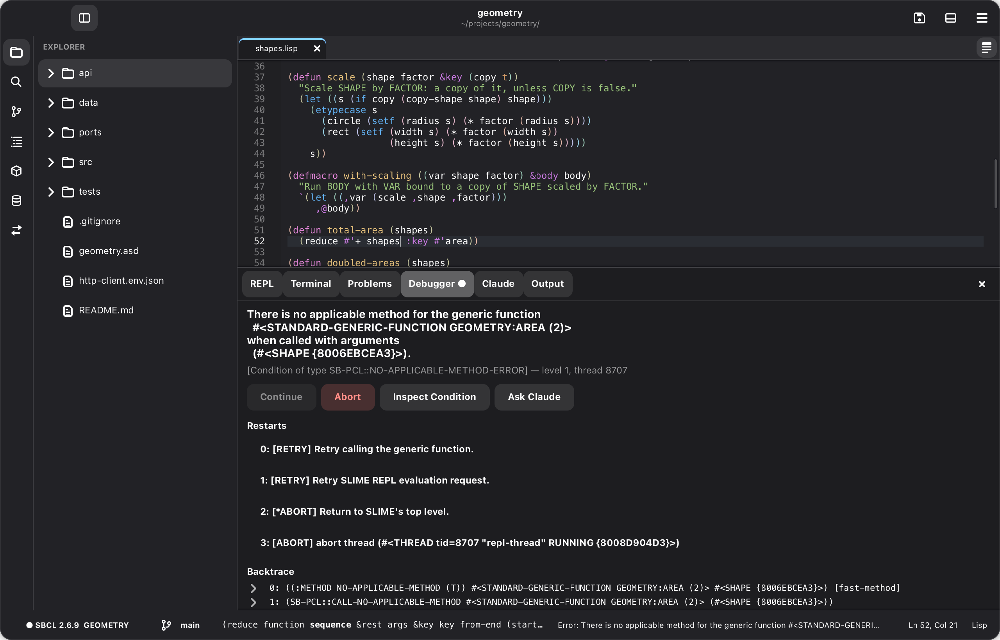
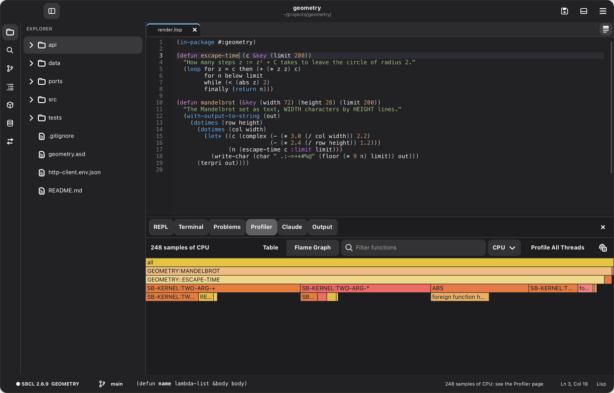
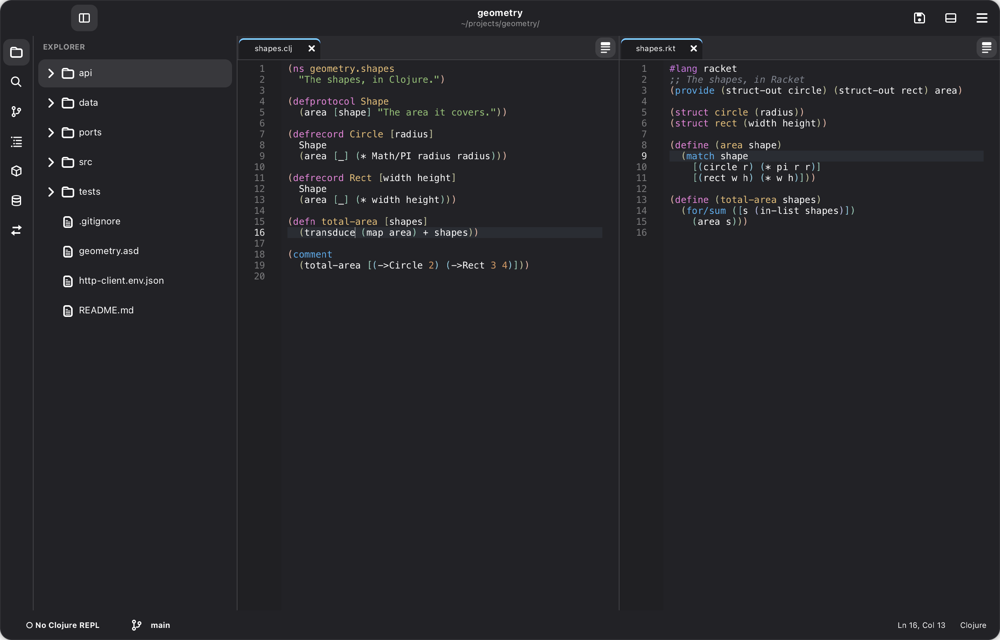
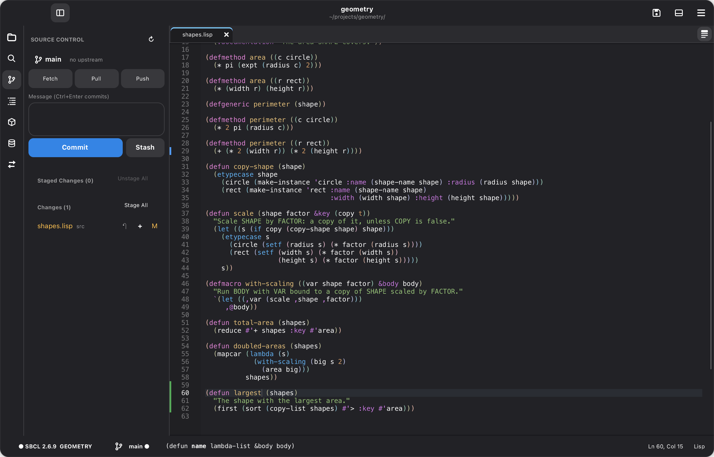
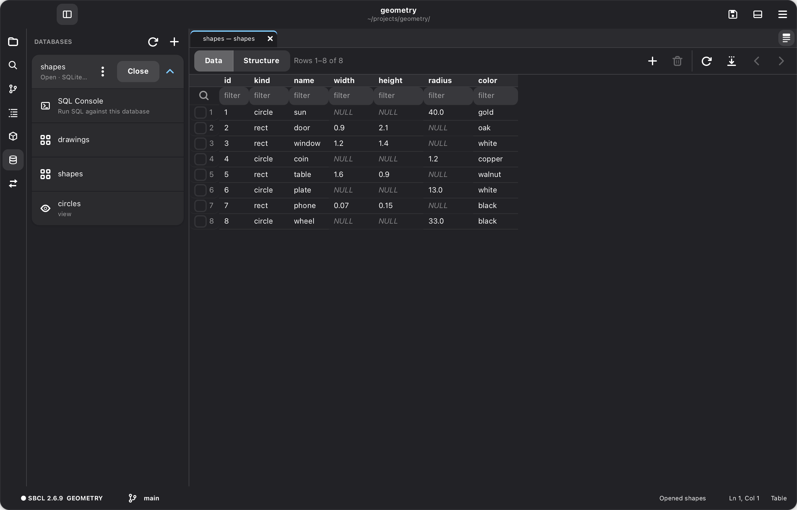

# Cadre

A Common Lisp editor, written in Common Lisp: Emacs's depth for Lisp, with an
interface like VS Code's. Built on the [gtk4](https://github.com/crazymevt/gtk4) bindings and libadwaita.

**Status:** version 1.1.0, for macOS and Linux ([CHANGELOG.md](CHANGELOG.md)),
editing Common Lisp, Racket and Clojure. [docs/DESIGN.md](docs/DESIGN.md) has
the design and the milestones it was built in.

## What it does

- **A live Lisp** through a bundled Swank: a REPL, evaluating and compiling
  as you go, compiler notes in the code, argument hints, completion, go to
  definition, and highlighting from the running image.
  [Common Lisp](docs/manual/common-lisp.md)
- **Lisp tools:** a debugger, an inspector, cross-references, tracing, a
  stepper, a profiler with flame graphs, a Threads page, macros expanded in
  place, and the HyperSpec beside your code.
- **Projects:** ASDF systems, New Project, libraries from Quicklisp, a Tests
  page for Parachute and FiveAM, and ▶ to run a project's program, GTK apps
  included. [Projects](docs/manual/projects.md)
- **Racket and Clojure**, edited the same way: Clojure through nREPL as in
  CIDER, Racket through Cadre's own back end. [Racket and Clojure](docs/manual/racket-clojure.md)
- **Emacs depth** in two key profiles, Standard and Emacs: structural editing
  and paredit, the kill ring, the mark, incremental search, keyboard macros.
  [Editing](docs/manual/editing.md)
- **Claude**, through the Claude Code CLI, with the editor as context: it
  reads your buffers, asks your running Lisp, and proposes edits as diffs you
  accept or reject. [Claude](docs/manual/using-claude.md)
- **And:** Git, a terminal, databases (SQLite, PostgreSQL, MySQL), HTTP
  requests kept in `.http` files, JavaScript, HTML, CSS, JSON and XML
  through tree-sitter, Markdown previews, color themes, and a settings page
  for every option.

The [manual](docs/manual/README.md) covers each of these, and the
[gallery](docs/gallery/README.md) shows them.

<table>
  <tr>
    <td width="50%"> The debugger</td>
    <td width="50%"> The profiler</td>
  </tr>
  <tr>
    <td> Racket and Clojure</td>
    <td> Git</td>
  </tr>
  <tr>
    <td> Databases</td>
    <td> Claude</td>
  </tr>
</table>

## Installing a release

The [Releases](https://github.com/crazymevt/cadre-editor/releases) page has
packages with Cadre compiled in:

- **macOS** (Apple silicon, macOS 15 or newer): open the `.dmg` and drag
  Cadre to Applications. It carries its own GTK. It isn't signed by a
  registered developer yet, so macOS blocks it the first time: open System
  Settings → Privacy & Security and choose **Open Anyway** (or run `xattr -dr
  com.apple.quarantine /Applications/Cadre.app`).
- **Linux** (x86-64, with GTK 4.14+ and libadwaita 1.5+, as on Ubuntu 24.04
  or newer): install the `.deb` (`sudo apt install ./cadre_*.deb`), or unpack
  the `.tar.gz` anywhere and run `bin/cadre`.

For the REPL, install a Lisp (`brew install sbcl`, or `sudo apt install
sbcl`). Git, Claude Code, Racket, the Clojure CLI, tree-sitter and Prettier
are used when they're installed.

To run Cadre from source instead, see
[Installing and running](docs/manual/installing.md#setup): SBCL, Quicklisp,
GTK 4 and libadwaita, and two libraries checked out beside Cadre, then
`make run`.

## Development

`make test` runs the headless tests and `make smoke` drives a real window
through every feature; [docs/DEVELOPMENT.md](docs/DEVELOPMENT.md) has the
rest, and [docs/RELEASING.md](docs/RELEASING.md) how a release is made.

## License

MIT.
