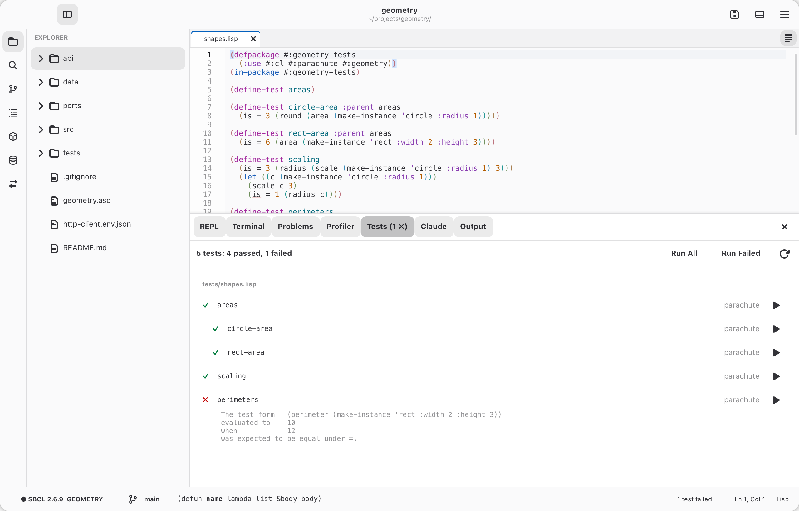
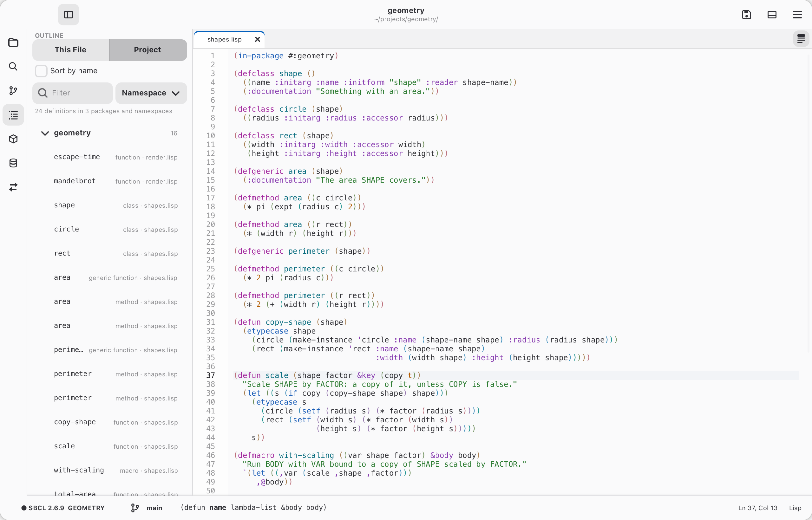
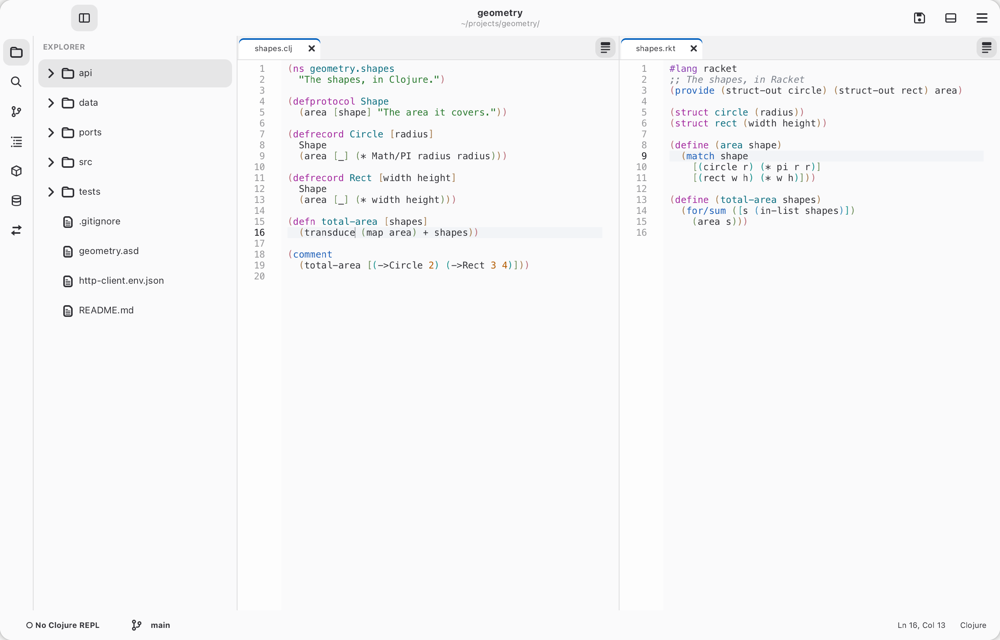
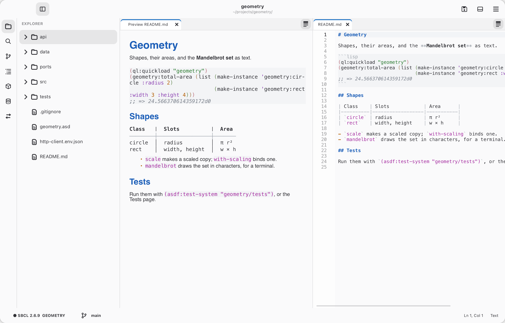

# Gallery

Cadre at work on a small project. The pictures follow your GitHub theme:
light, or dark. `make gallery` takes them again from a real window
(`scripts/gallery.lisp`), so they show the Cadre in this repository.

## Editing Lisp

A connected Lisp, the REPL below, and the parameters of the call being typed
in the status bar. [Editing](../manual/editing.md) · [Common Lisp](../manual/common-lisp.md)

<picture>
  <source media="(prefers-color-scheme: dark)" srcset="dark/editing.png">
  
</picture>

## The debugger

The condition, its restarts, and the backtrace, with each frame's locals a
click away. [The debugger](../manual/common-lisp.md#the-debugger)

<picture>
  <source media="(prefers-color-scheme: dark)" srcset="dark/debugger.png">
  
</picture>

## The profiler

Where the time goes, as a flame graph (or a table of functions).
[Profiling](../manual/common-lisp.md#profiling)

<picture>
  <source media="(prefers-color-scheme: dark)" srcset="dark/profiler.png">
  
</picture>

## Tests

The project's tests, each passed or failed, to run all, the failed ones, or
one. [The Tests page](../manual/projects.md#the-tests-page)

<picture>
  <source media="(prefers-color-scheme: dark)" srcset="dark/tests.png">
  
</picture>

## Expanding a macro in place

The expansion replaces the form in the source, shaded, until it's collapsed.
[Expanding macros](../manual/common-lisp.md#expanding-macros)

<picture>
  <source media="(prefers-color-scheme: dark)" srcset="dark/expand-in-place.png">
  
</picture>

## The project's outline

Every definition in the project, by package or namespace.
[Outline](../manual/editing.md#outline)

<picture>
  <source media="(prefers-color-scheme: dark)" srcset="dark/outline.png">
  
</picture>

## The HyperSpec

The standard's entry for a symbol, beside the code.
[The HyperSpec](../manual/common-lisp.md#the-hyperspec)

<picture>
  <source media="(prefers-color-scheme: dark)" srcset="dark/hyperspec.png">
  
</picture>

## Racket and Clojure

Both edit like Common Lisp, and both run. [Racket and Clojure](../manual/racket-clojure.md)

<picture>
  <source media="(prefers-color-scheme: dark)" srcset="dark/racket-clojure.png">
  
</picture>

## Git

Changes in the gutter, and the Source Control page.
[Git](../manual/git.md)

<picture>
  <source media="(prefers-color-scheme: dark)" srcset="dark/git.png">
  
</picture>

## Databases

A table in a tab, filtered, sorted and edited in place.
[Databases](../manual/databases.md)

<picture>
  <source media="(prefers-color-scheme: dark)" srcset="dark/databases.png">
  
</picture>

## API requests

Requests kept in the project's `.http` files, sent through curl.
[API requests](../manual/api.md)

<picture>
  <source media="(prefers-color-scheme: dark)" srcset="dark/api.png">
  
</picture>

## Markdown

A live preview beside the file. [Markdown](../manual/editing.md#markdown)

<picture>
  <source media="(prefers-color-scheme: dark)" srcset="dark/markdown.png">
  
</picture>

## Claude

Claude explaining code in the side panel, with the editor as context.
[Claude](../manual/using-claude.md)

