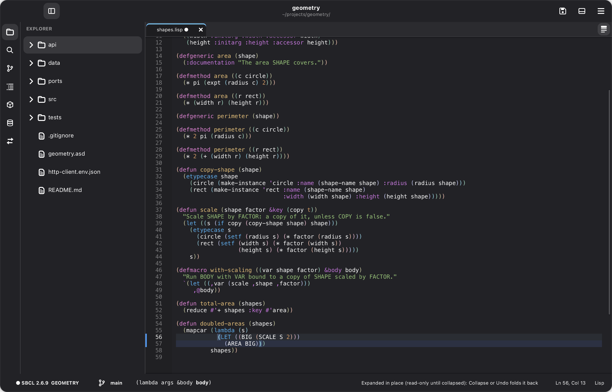
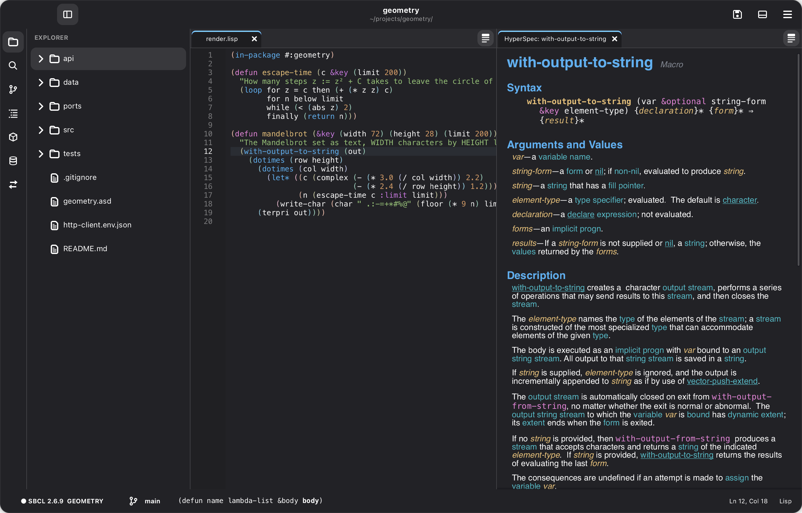
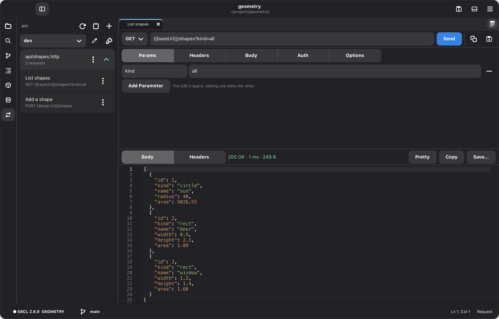

# Gallery

Cadre at work on a small project, in its dark theme ([Themes](#themes)
shows the light one too). `make gallery` takes them again from a real
window (`scripts/gallery.lisp`), so they show the Cadre in this repository.

## Editing Lisp

A connected Lisp, the REPL below, and the parameters of the call being typed
in the status bar. [Editing](../manual/editing.md) · [Common Lisp](../manual/common-lisp.md)

## Themes

Cadre Dark and Cadre Light, the two it comes with; it follows the system's
choice between them. Solarized and High Contrast are there too.
[Settings and themes](../manual/settings.md)

<table>
  <tr>
    <td width="50%"> Cadre Dark</td>
    <td width="50%"> Cadre Light</td>
  </tr>
</table>

## The debugger

The condition, its restarts, and the backtrace, with each frame's locals a
click away. [The debugger](../manual/common-lisp.md#the-debugger)

## The profiler

Where the time goes, as a flame graph (or a table of functions).
[Profiling](../manual/common-lisp.md#profiling)

## Tests

The project's tests, each passed or failed, to run all, the failed ones, or
one. [The Tests page](../manual/projects.md#the-tests-page)

## Expanding a macro in place

The expansion replaces the form in the source, shaded, until it's collapsed.
[Expanding macros](../manual/common-lisp.md#expanding-macros)

## The project's outline

Every definition in the project, by package or namespace.
[Outline](../manual/editing.md#outline)

## The HyperSpec

The standard's entry for a symbol, beside the code.
[The HyperSpec](../manual/common-lisp.md#the-hyperspec)

## Racket and Clojure

Both edit like Common Lisp, and both run. [Racket and Clojure](../manual/racket-clojure.md)

## Git

Changes in the gutter, and the Source Control page.
[Git](../manual/git.md)

## Databases

A table in a tab, filtered, sorted and edited in place.
[Databases](../manual/databases.md)

## API requests

Requests kept in the project's `.http` files, sent through curl.
[API requests](../manual/api.md)

## Markdown

A live preview beside the file. [Markdown](../manual/editing.md#markdown)

## Claude

Claude explaining code in the side panel, with the editor as context.
[Claude](../manual/using-claude.md)

