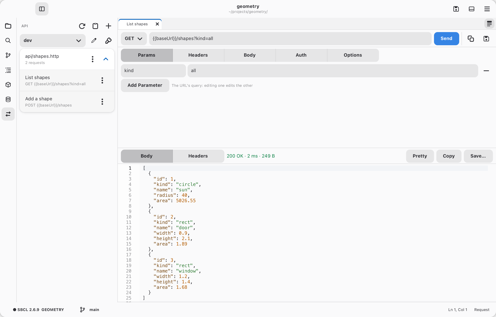

# API requests

<picture>
  <source media="(prefers-color-scheme: dark)" srcset="../gallery/dark/api.png">
  
</picture>

The API page (⇄ in the activity bar) is a front end to `curl` for trying
out HTTP APIs. Requests are kept in `.http` files in the project, the format
VS Code's REST Client and JetBrains' HTTP Client use, so you can commit them
and other tools can run them:

```http
## List users
GET {{baseUrl}}/users?page=1
Authorization: Bearer {{token}}

## Add a user
POST {{baseUrl}}/users
Content-Type: application/json

{"name": "Ann"}
```

- **+** opens a new request in a tab: method, URL and **Send**; its
  query parameters (**Params**, kept in step with the URL: edit either),
  headers, body and options (follow redirects, skip TLS checks, timeout);
  and the response below: status, time, size, headers and body. JSON, XML
  and HTML bodies are highlighted, and JSON and XML are laid out (**Pretty**
  off shows them as they came).
- **Save** (`Ctrl+S`) asks which `.http` file in the project the request
  goes in (`api/requests.http` to start with; with no folder open, your own
  in `~/.config/cadre/api/`). If it holds something that looks like a
  secret (an `Authorization` header, a `password` or `api_key` field), it
  offers to move it to the secrets and leave a `{{variable}}` instead.
  Requests you send without saving are kept in **History**.
- `{{variables}}` come from `@name = value` lines in the file, then the
  environment chosen at the top of the page. Environments are in the
  project's `http-client.env.json` (✎ edits it; `"$shared"` holds variables
  for all of them). Secrets have the same shape but live outside the project,
  in `~/.config/cadre/secrets/`, readable only by you, so they're never
  committed (🔑 edits them). `{{$guid}}`, `{{$timestamp}}`,
  `{{$isoTimestamp}}` and `{{$randomInt}}` are made up when sent.
- The **Body** is text (`< ./payload.json` sends a file as it is), a
  **Form** (fields, sent `application/x-www-form-urlencoded`) or
  **Multipart** (text parts and files, sent `multipart/form-data` as
  `curl -F` does). Multipart parts are kept in the file in the usual form,
  a file as `< ./photo.png` beside the `.http` file.
- **Auth** sets up authentication: a Bearer token, Basic (username and
  password) or an API key header. **Use** keeps the secret in this project's
  secrets and gives the request the header with a `{{variable}}`
  (`Authorization: Bearer {{token}}`); the tab recognizes such headers in
  requests you open.
- **Cookies** a server sets are kept, one jar for each environment, and sent
  back with the requests after (a login's session). The jar is outside the
  project (`~/.config/cadre/api/cookies/`); the page lists its cookies, with
  Clear. A request can leave it out: **Keep cookies** off in Options, or
  `# @no-cookie-jar` in the file.
- **Capture** values from a response for the requests after it, such as a
  login's token: in a request's Options, or in the file as
  `# @capture token = $.token` (a JSON path like `$.data[0].id`,
  `header Location`, or `status`). Captured values come before the
  environment and the secrets, are listed on the page (with Clear), and are
  kept only until Cadre quits.
- Copy as curl (in a tab, or a request's ⋮ menu) copies a command line with
  the values filled in; the paste button imports one (as a browser's Copy
  as cURL gives).
- In a `.http` file, `Ctrl+Enter` (`C-c C-c`) sends the request at the
  cursor.

Headers and secrets go to `curl` on its standard input, not its command
line, so they don't show in the process list.
