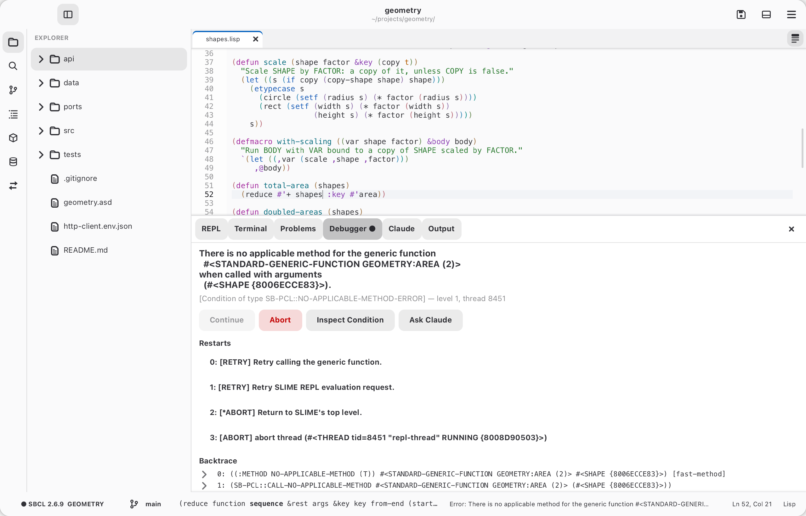
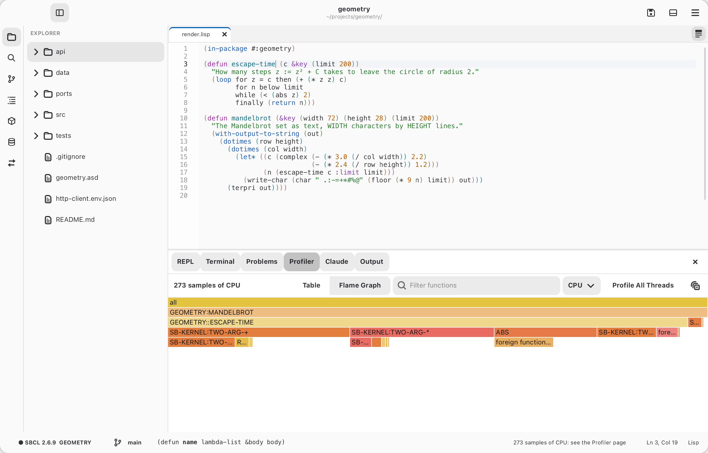
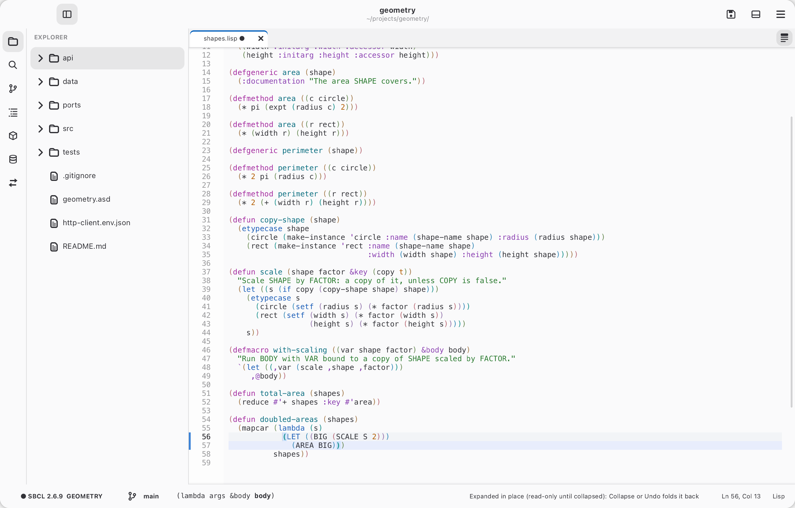
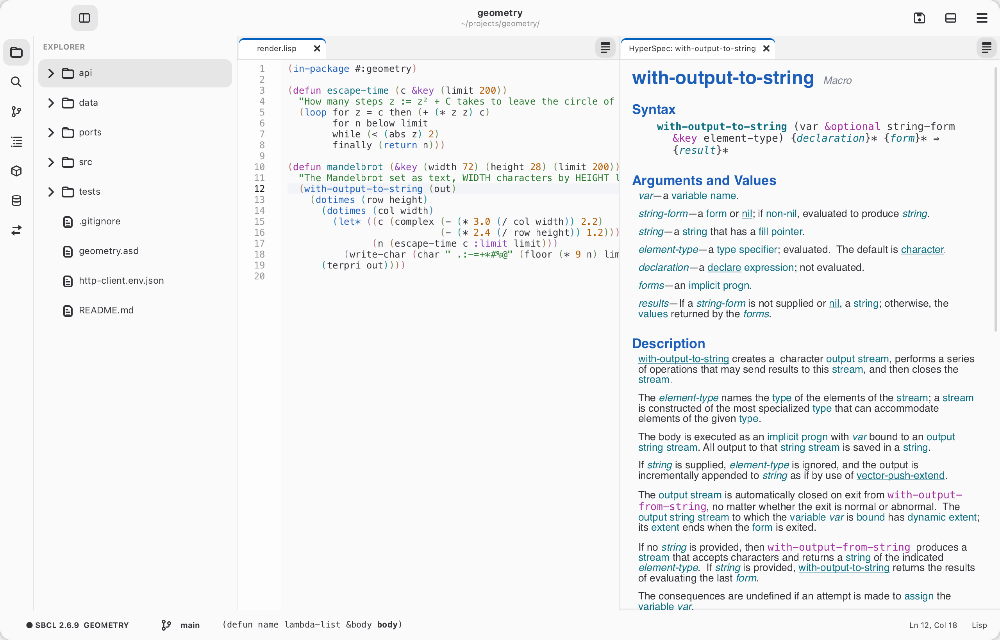

# Common Lisp

## Talking to the Lisp

Talking to the Lisp, in Lisp files (Cadre starts a Lisp with `*lisp-command*`,
`sbcl` by default, the first time one is needed):

| Action | Standard (⌘ on macOS) | Emacs |
| --- | --- | --- |
| Evaluate or compile top-level form (definitions compile, other forms show their value) | `Ctrl+Return` | — |
| Compile top-level form | (palette) | `C-c C-c` |
| Evaluate top-level form | (palette) | `C-M-x` |
| Evaluate expression before cursor / selection | `Ctrl+Shift+Return` | `C-x C-e` / `C-c C-r` |
| Compile and load file | `Ctrl+Alt+Return` | `C-c C-k` |
| Go to definition / back | `F12` / `Ctrl+Alt+-` | `M-.` / `M-,` |
| Describe symbol | `Ctrl+K Ctrl+I` | `C-c C-d d` |
| Look up in the HyperSpec | `Ctrl+K H` | `C-c C-d h` |
| Complete symbol | `Ctrl+Space` | `C-M-i` |
| Next / previous compiler note | `F8` / `Shift+F8` | `M-n` / `M-p` |
| Show the REPL | `` Ctrl+` `` | `C-c C-z` |
| Show the Terminal | `` Ctrl+Shift+` `` | `C-x p s` |
| Claude Code in a Terminal | (palette) | `C-c C-a t` |
| Load the folder's ASDF system into the Lisp | `F6` | `C-c L` |
| Build the project's program | `Ctrl+Shift+B` | `C-x p c` |
| Run the project's tests in the REPL / in a new Lisp | `Ctrl+; A` / `Ctrl+; N` | `C-x p t` / `C-x p T` |
| Run / stop the project's GTK app (keeping the REPL) | `Ctrl+F5` / `Ctrl+Shift+F5` | `C-x p r` / `C-x p k` |
| Inspect a value | `Ctrl+K I` | `C-c I` |
| Find references (all kinds) | `Shift+F12` | `M-?` |
| Who calls / references / binds / sets | (palette) | `C-c C-w c` / `r` / `b` / `s` |
| Who expands a macro / specializes a class | (palette) | `C-c C-w m` / `a` |
| Callers / callees | (palette) | `C-c <` / `C-c >` |
| Macroexpand once / completely | `Ctrl+K Ctrl+M` / `Ctrl+K Ctrl+A` | `C-c C-m` / `C-c M-m` |
| Expand the macro in place / collapse it | `Ctrl+K Ctrl+E` / `Ctrl+K Ctrl+U` | `C-c M-e` / `C-c M-u` |
| Trace / untrace the function at the cursor | `Ctrl+K T` | `C-c C-t` |
| Show the Trace page | `Ctrl+K Shift+T` | `C-c T` |
| Profile the form (or a call of the definition) | `Ctrl+K P` | `C-c M-p` |
| Show the Profiler page | `Ctrl+K Shift+P` | `C-c P` |
| Open the project's scratch buffer | `Ctrl+K Shift+S` | `C-x M-s` |
| Step through the form (or a call of the definition) | `F11` | `C-c M-s` |
| Compile the form with full debug information | `Ctrl+K D` | `C-c M-c` |
| While stepping: step over / step out | `F10` / `Shift+F11` | `x` / `o` in the Stepper |
| Fold / unfold the form or section | `Ctrl+Shift+[` / `Ctrl+Shift+]` | `C-c @ C-h` / `C-c @ C-s` |
| Toggle the fold at the cursor | `Ctrl+K Ctrl+.` | `C-c @ C-c` |
| Format Document | `Shift+Alt+F` | `C-c f` |
| Fold all / unfold all | `Ctrl+K Ctrl+0` / `Ctrl+K Ctrl+J` | `C-c @ C-M-h` / `C-c @ C-M-s` |
| Show the explorer | `Ctrl+Shift+E` | — |

Values from evaluating appear inline after the form (`⇒ 42`) until you edit,
and in the status bar.

## Image-aware highlighting

Symbols are colored by what the connected Lisp knows: your macros like Common
Lisp's, special variables and constants, and calls to functions that don't
exist underlined. Set `*highlight-from-image*` to `nil` to turn this off.

## The REPL

In the REPL, `↑` and `↓` on the input's first or last line step through
earlier inputs (going past the newest brings back what you were typing), as
do `M-p`/`M-n`; the history is kept per project between sessions.

REPL results are live objects: click one to inspect it, or right-click it:
- **Copy to Input** puts it in the input, where it stands for the object
  itself (not its printed text) when you send the form.
- **Copy Value** copies its text: a string's own characters, without the
  quotes and backslashes the REPL shows, or anything else printed in full.
- **Open in New Tab** puts that text in a new, unsaved tab, in the mode it
  looks like (XML, HTML, JSON or Lisp), ready for Format Document.

In the Inspector, right-click a value for the same Copy Value and Open in
New Tab, or right-click elsewhere for the object being inspected.

In the REPL: `Return` sends a complete form, `M-p`/`M-n` (or `Ctrl+↑`/`Ctrl+↓`)
walk the history, `Tab` completes. `M-x connect` connects to a Swank server
you started yourself.

## The debugger

In the debugger, digits choose a restart, `a` aborts and `c` continues. Open a
frame to see its locals (click one to inspect it) and to evaluate in the frame.

<picture>
  <source media="(prefers-color-scheme: dark)" srcset="../gallery/dark/debugger.png">
  
</picture>

## Tracing

**Tracing** records each call of a traced function on the Trace page, as a
tree: calls made inside a call sit under it, with their arguments and values
(or "exited non-locally" when an error left them). Click an argument or a
value to inspect it, and click a call to fold the calls inside. New calls
appear while the page is open. Trace a function from its right-click menu
(Debug › Trace / Untrace Function), with the `+` on the page (which also takes
names such as `(setf foo)`), or with the keys above. Clear forgets the calls
recorded so far, and Untrace All stops tracing.

## Profiling

**Profiling** (SBCL, with `sb-sprof`) shows where a program spends its time.
Profile Form (`Ctrl+K P`, or Debug › Profile Form in the right-click menu) runs
the form at the cursor, or the selection, with the profiler sampling it; on a
definition it asks which call to profile. Profile All Threads, on the Profiler
page, samples the whole Lisp (a running app too) until you press Stop; the
menu beside it chooses what a sample counts: CPU time, allocation, or wall
time. The page lists the functions seen, by **self** (running that function
itself) and **total** (anywhere on the stack); choose one to see what called
it and what it called, and Go to Definition to open its source. **Flame
Graph** draws the stacks from the top down, each call as wide as the samples
it was in: click a box to zoom into it, and one above to zoom back out.

<picture>
  <source media="(prefers-color-scheme: dark)" srcset="../gallery/dark/profiler.png">
  
</picture>

## Stepping

**Stepping:** Step Through Form (`F11`) evaluates the form at the cursor, or
the selection, under `cl:step`. On a definition it first compiles it for
stepping and then asks which call to step, such as `(step-me 3)`. The Lisp
stops before each function call. The Debugger page becomes the Stepper, shows
the call and its arguments, and highlights it in the source. **Step Into**
(`s`) goes into the call, **Step Over** (`x`) makes it whole, **Step Out** (`o`)
finishes the current function, and **Resume** (`c`) runs on. Only code
compiled for stepping stops, so to step into a function, compile it first with
Compile for Debugging (`Ctrl+K D`, or `C-c M-c`). That compiles it with
`(debug 3)`, which also shows all of its locals in the debugger. After a
`(break)`, the debugger's Step button continues to the next call compiled for
stepping.

## Expanding macros

Expanding a macro inside the *Macroexpansion* tab expands it there, in place.
**Expand in Place** (`Ctrl+K Ctrl+E`, or Lisp › Expand in Place) replaces the
macro form at the cursor with its expansion right in the file, shaded;
expanding a form inside it steps further in. **Collapse** (`Ctrl+K Ctrl+U`)
or Undo folds the last expansion back, and Collapse All all of them. The file
is read-only while anything is expanded, the undo history from before stays,
and saving collapses everything first, so an expansion never reaches the file.

<picture>
  <source media="(prefers-color-scheme: dark)" srcset="../gallery/dark/expand-in-place.png">
  
</picture>

## Threads

**Threads** (Lisp › Threads; its tab also appears when an app starts) lists
the Lisp's threads: a server's, a GTK app's, background work. **Debug**
interrupts one and opens the debugger in it, with its backtrace and locals;
Continue lets it go on. **Kill** ends it, after asking. Swank's own threads
are hidden unless you tick Swank's threads.

## Scratch buffers

**Scratch Buffer** (`Ctrl+K Shift+S`, `C-x M-s` in the Emacs keys, or the
Lisp menu) opens `*scratch*`, a Lisp buffer
for trying things out. Each project has its own, kept between sessions but
outside the project's folder (in `~/.config/cadre/scratch/`), so it never shows
up in Git. It saves itself as you type and never asks to be saved.

## The HyperSpec

Right-click a symbol in Lisp code and choose Look Up in HyperSpec
(`Ctrl+K H`, `C-c C-d h` in Emacs) to read the standard's entry for it in a
tab beside the code: syntax, arguments, description and highlighted
examples, with links to other entries. A symbol with several entries (`list`
is a function and a class) offers a choice. Back and Forward are at the top
of the page, and on `Alt+Left` / `Alt+Right` and the mouse's side buttons.
Search HyperSpec (in the Lisp menu) finds any entry by name. The text is the
dpANS3 draft the ANSI standard was made from, converted by
[spec-browser](https://github.com/crazymevt/spec-browser) into `data/docsets/common-lisp/`. That copy is
committed, so Cadre doesn't need spec-browser. After rebuilding the docset
there (`make export`), copy it over:
`cp ../spec-browser/data/common-lisp/*.sexp data/docsets/common-lisp/`.


Drag the HyperSpec tab into the main tab bar to read it at full width:


Other libraries' documentation shows too, and lookups follow the package a
symbol is written with (`bt:make-thread`):
- **[gtk4](https://github.com/crazymevt/gtk4) and [raylib](https://github.com/crazymevt/raylib)**, once they've built their docsets (`make docset` in each).
- **Any docset in `~/.local/share/docsets/`.** The
  [docsets](https://github.com/crazymevt/docsets) project writes them for
  other libraries (bordeaux-threads, alexandria, uiop, plump, jzon, dexador,
  parachute, cffi and cl-ppcre so far), and any library can be documented
  from its docstrings. To add them:

  ```sh
  git clone https://github.com/crazymevt/docsets.git ~/projects/lisp/docsets
  make -C ~/projects/lisp/docsets all
  ```

  It needs the docset library linked into Quicklisp's local projects, as in
  [Setup](installing.md#setup). After updating Quicklisp, `make -C ~/projects/lisp/docsets
  update` regenerates the docsets whose libraries changed (`make outdated`
  lists them).

<picture>
  <source media="(prefers-color-scheme: dark)" srcset="../gallery/dark/hyperspec.png">
  
</picture>
