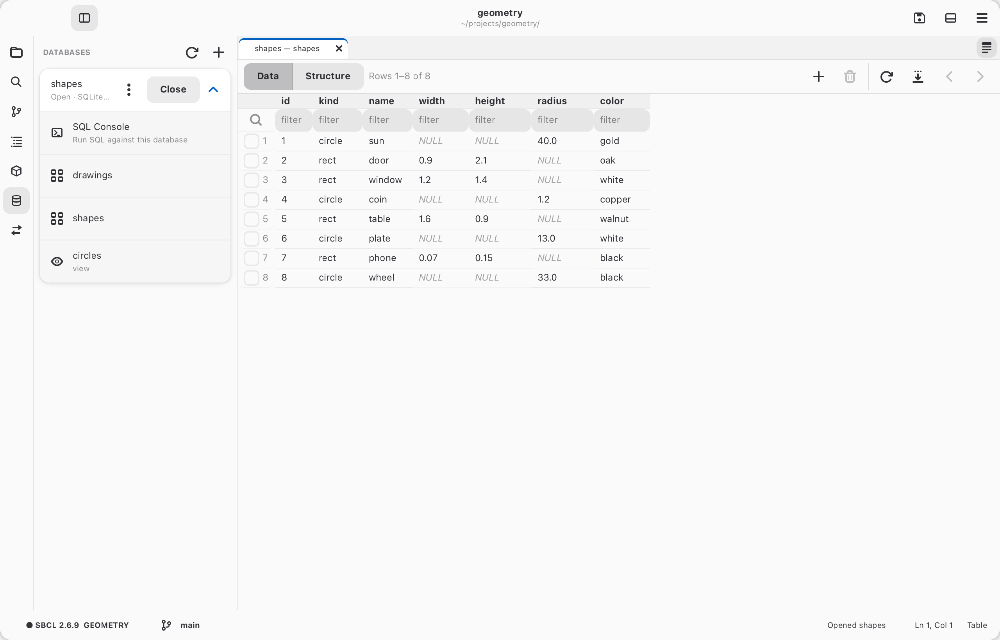

# Databases

<picture>
  <source media="(prefers-color-scheme: dark)" srcset="../gallery/dark/databases.png">
  
</picture>

The Databases page (the cylinder in the activity bar) keeps your database
connections: SQLite files, through the `libsqlite3` macOS and Linux already
have; PostgreSQL servers, through cl-postgres; and MySQL and MariaDB
servers, through qmynd. The server clients are written in Lisp, so there's
nothing to install; they don't use SSL yet.

- **+** adds a connection: a name, the database file (**Choose…** an existing
  one or **New…** for an empty one) or, for a server, the host, port,
  database, user and password, **Read-only**, and **Save with the
  project**. A password is never saved with the connection: it's kept in
  `~/.config/cadre/secrets/database-passwords.json`, which only you can read. A project's connections go in its `.cadre/databases.sexp`, with
  the file's path relative to the project, so you can commit them; the others
  are yours alone, in `~/.config/cadre/databases.sexp`. **Test Connection**
  tries it.
- A connection's **Open** / **Close**, and its ⋮ menu: New SQL Console,
  Refresh Tables, Edit…, Duplicate and Delete… (which forgets the connection,
  not the database). Expanding a closed connection opens it.
- An open connection lists its tables and views. A table opens in a tab, a
  page of rows at a time (`*db-page-size*`, 100), with a filter above each
  column: text the column contains, or `=`, `!=`, `<`, `>`, `<=`, `>=` a value,
  `NULL` or `!NULL` (text is found in any case). Rows come in key order
  until you click a column's name to sort by it (again: descending;
  again: unsorted). **Structure** shows the columns, indexes, foreign keys and
  the `CREATE` statement; ⤓ saves the rows shown as CSV.
- A table with a key can be edited (not a view, or a read-only connection):
  double-click a cell to change it, **+** adds a row (empty cells get the
  column's default), and checked rows are deleted with 🗑. Right-click a cell
  to edit long or multi-line text, set it to NULL, copy it, or filter by it.
  Changes are colored and held until **Save** (`Ctrl+S`) writes them all in
  one transaction, or **Discard** drops them; closing the tab asks.
- A **SQL console** is a SQL buffer tied to a connection; any `.sql` file
  can be too (it asks which the first time). SQL is highlighted, with an
  outline of its tables and views, once its grammar is installed
  (`M-x install-language-grammar`, SQL). Completion (`Ctrl+Space`, or as
  you type) offers the open connection's tables, their columns (all, or one
  table's after `orders.`) and SQL's keywords. The Results page in the panel
  shows the rows (up to `*db-result-limit*`, 500), how long it took, or how
  many rows changed; **Copy as CSV** copies them, and **Stop** stops a slow
  query.

| Action | Standard (⌘ on macOS) | Emacs |
| --- | --- | --- |
| Run the statement at the cursor (or the selection) | `Ctrl+Enter` | `C-c C-c` |
| Run the whole file | `Ctrl+Shift+Enter` | `C-c C-b` |
| Choose the connection it runs against | `M-x db-choose-connection` | `C-c C-d` |
