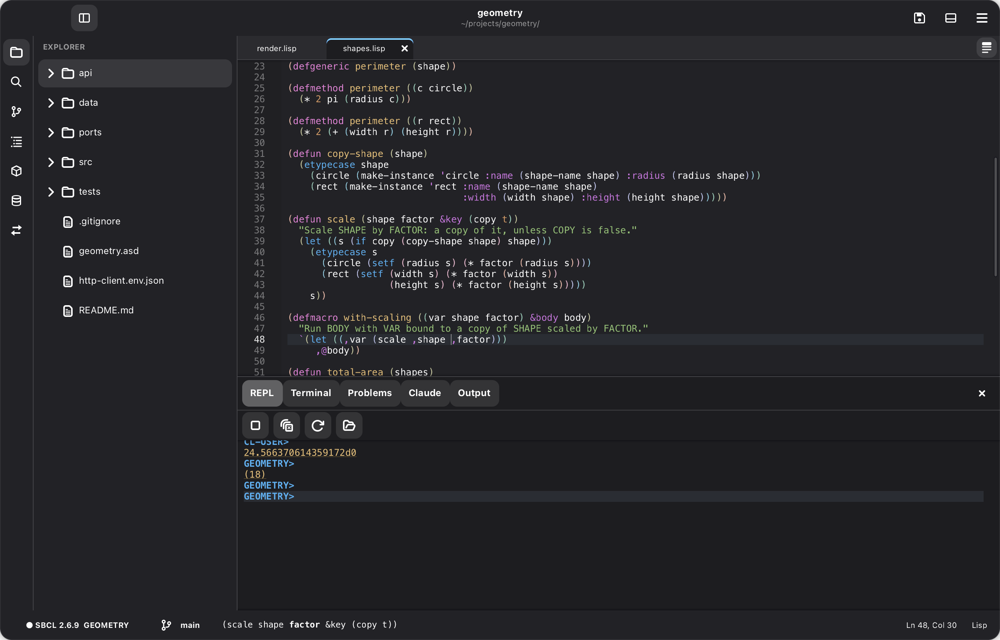
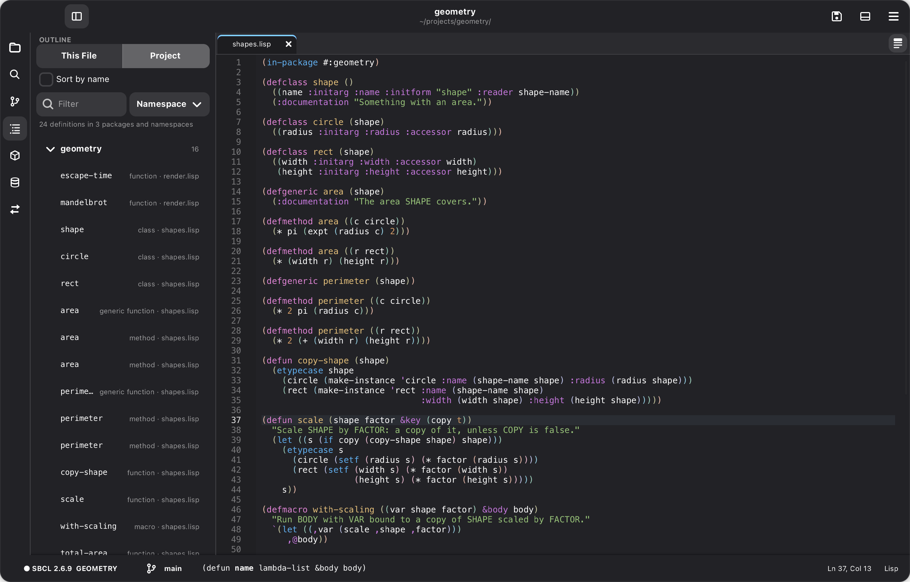
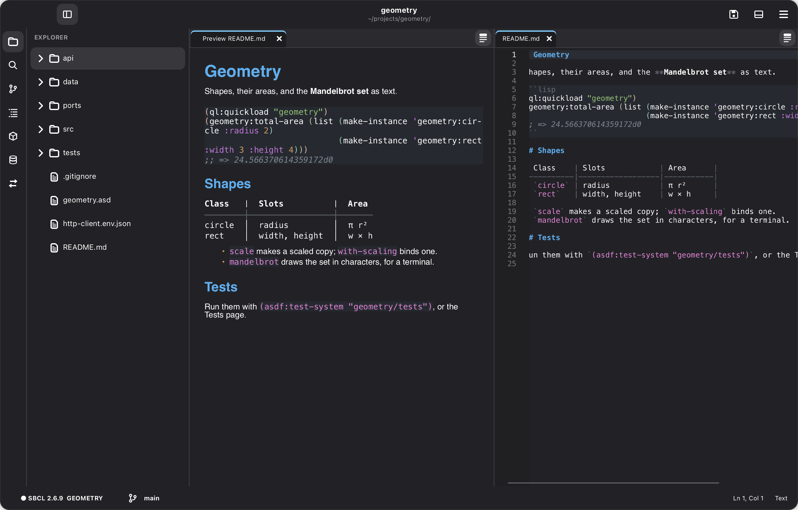

# Editing

## Keys

The first run asks which keyboard shortcuts to use.

| Action | Standard (⌘ on macOS) | Emacs |
| --- | --- | --- |
| Open file | `Ctrl+O` | `C-x C-f` |
| Open folder | `Ctrl+K Ctrl+O` | `C-x d` |
| Save / Save as | `Ctrl+S` / `Ctrl+Shift+S` | `C-x C-s` / `C-x C-w` |
| New file | `Ctrl+N` | — |
| Close tab | `Ctrl+W` | `C-x k` |
| Next / previous tab | `Ctrl+Tab` / `Ctrl+Shift+Tab` | `C-x →` / `C-x ←` |
| Toggle sidebar / panel | `Ctrl+B` / `Ctrl+J` | `C-x t s` / `C-x t p` |
| Toggle layout | `Ctrl+K Ctrl+L` | `C-x t l` |
| Command palette | `Ctrl+Shift+P`, `F1` | `M-x` |
| Quick open (file by name) | `Ctrl+P` | `C-x p f` |
| Switch buffer | (palette) | `C-x b` |
| Find / next / previous | `Ctrl+F` / `F3` / `Shift+F3` | `C-s` / `C-s` / `C-r` |
| Go to line | `Ctrl+G` | `M-g g` |
| Quit | `Ctrl+Q` | `C-x C-c` |

In Lisp files, in both profiles:

| Action | Keys |
| --- | --- |
| Indent line or selection / new line, indented | `Tab` / `Return` |
| Forward / backward s-expression | `C-M-f` / `C-M-b` |
| Up / down a list | `C-M-u` / `C-M-d` |
| Start / end of top-level form | `C-M-a` / `C-M-e` |
| Select s-expression | `C-M-Space` |
| Indent top-level form / selection | `C-M-q` / `C-M-\` |

(`C-M-` is Ctrl+Alt; on macOS, Ctrl+Option. In the Emacs profile on macOS, ⌘ with a key Emacs leaves unbound does what it does in Standard: ⌘↩ evaluates, ⌘S saves, ⌘F finds.)

## Everyday editing

| Action | Standard (⌘ on macOS) | Emacs |
| --- | --- | --- |
| Bigger / smaller / normal text | `Ctrl+=` / `Ctrl+-` / `Ctrl+0` | `C-x C-=` / `C-x C--` / `C-x C-0` |
| Word wrap in this editor | `Alt+Z` | `M-x toggle-word-wrap` |
| Move line(s) up / down | `Alt+↑` / `Alt+↓` | `C-S-↑` / `C-S-↓` |
| Copy line(s) up / down | `Alt+Shift+↑` / `Alt+Shift+↓` | `C-S-d` (down) |
| Open a recent folder / file | `Ctrl+R` / `Ctrl+K Ctrl+R` | `M-x open-recent-project` / `C-x C-r` |
| Rectangles: kill, copy, yank, delete, open, clear, replace | `M-x kill-rectangle` … | `C-x r k`, `C-x r M-w`, `C-x r y`, `C-x r d`, `C-x r o`, `C-x r c`, `C-x r t` |

Go to Definition and Find References work without a running Lisp too: they
use the definitions in your source, and search the project for the symbol.
`*word-wrap*` wraps new editors; the zoom is saved as `*editor-zoom*`.

## Emacs depth

| Action | Standard (⌘ on macOS) | Emacs |
| --- | --- | --- |
| Split right / below | `Ctrl+\` / `Ctrl+K Ctrl+\` | `C-x 3` / `C-x 2` |
| Next group / group 1, 2, 3 | — / `Ctrl+1`, `Ctrl+2`, `Ctrl+3` | `C-x o` |
| Close this group / all other groups | `Ctrl+K W` / `Ctrl+K Ctrl+W` | `C-x 0` / `C-x 1` |
| Move tab to the next group | `Ctrl+Alt+→` | (palette) |
| Find and replace | `Ctrl+H` | `M-%` (query-replace) |
| Incremental search forward / backward | (find bar) | `C-s` / `C-r` |
| Toggle comment | `Ctrl+/` | `M-;` |
| Delete line | `Ctrl+Shift+K` | `C-S-Backspace` |
| Editor REPL (Cadre's own image) | `Ctrl+Shift+R` | `C-c R` |
| Evaluate in Cadre's image | (palette) | `M-:` |
| Describe key | `Ctrl+K Ctrl+K` | `C-h k` |
| Describe command / where is / all bindings | (palette) | `C-h f` / `C-h w` / `C-h b` |

The Emacs profile also has the kill ring (`C-k`, `C-w`, `M-w`, `C-y`, `M-y`,
`M-d`, `M-DEL`, `C-M-k`), the mark (`C-SPC`, `C-u C-SPC` to go back,
`C-x C-x`, `C-x h`), `C-u` and `M-0`…`M-9` numeric arguments, keyboard macros
(`C-x (`, `C-x )`, `C-x e` then `e` to repeat, or `F3`/`F4`), and `C-o`,
`C-t`, `M-u`/`M-l`/`M-c`, `M-\`, `M-SPC`, `M-^`, `M-m`, `C-l` and `M-/`. The
kill ring and the system clipboard stay in step, so `C-y` pastes what you
copied elsewhere and `M-y` (not right after a yank) picks from the ring.

Structural editing works in Lisp buffers and REPLs in both profiles:

| Action | Standard | Emacs |
| --- | --- | --- |
| Slurp / barf forward | `Ctrl+Alt+Shift+→` / `←` | `C-)` / `C-}` (or `C-→` / `C-←`) |
| Slurp / barf backward | (palette) | `C-(` / `C-{` |
| Raise / splice | `Ctrl+Alt+Shift+↑` / `↓` | `M-r` / `M-s` |
| Splice, killing backward / forward | (palette) | `M-↑` / `M-↓` |
| Wrap in parentheses | `Ctrl+Alt+Shift+9` | `M-(` |
| Split / join | (palette) | `M-S` / `M-J` |
| Kill expression | `Ctrl+Alt+Shift+K` | `C-M-k` |

`M-x paredit-mode` (saved as a setting) also keeps parentheses balanced as you
type: `(` and `"` insert pairs, `)` moves past the end of the list, `DEL` and
`C-d` step over parentheses instead of deleting half a pair, and `C-k` kills
whole expressions.

Cadre remembers each folder's open files, splits, cursor positions, panel and
sidebar, and whether a Lisp was running, and restores them the next time you
open that folder (without naming files). Turn this off with
`*restore-session*`, or just the Lisp with `*restore-lisp*`.

## Completion and hints

Completions appear as you type a symbol in Lisp code (after
`*auto-complete-min-chars*`, 2 by default; turn them off with
`*auto-complete*`), and `Ctrl+Space` / `C-M-i` asks for them anywhere. They
come from the definitions in your open buffers and your project's Lisp files,
from standard Common Lisp, from the words in the buffer and, when a Lisp is
connected, from that Lisp. The chosen one's parameters show below the list.
`Tab` or `Return` inserts it; `Return` ends the line instead if what you've
typed already is the choice.

Rest the mouse on a function, macro, variable or class to see its parameters
and documentation, and the status bar shows the parameters of the call
you're typing in, with the current argument in bold. Both read your source,
so they work for functions you've written but not loaded, and without a
Lisp (`*symbol-hover*` turns the tooltips off).

## Folding

Lisp forms that span lines, Markdown sections (a heading down to the next
heading at its level or above) and fenced code blocks fold away behind their
first line. Hover over the gutter to see ▾ on the lines that can fold, and
click it to fold. A folded line shows ▸ (click to unfold) and a faint band.
Folding again at the same place folds the form around it, and Fold All folds
every top-level form or section. Folds are also in the right-click menu and
the View menu. Folded text is never changed unseen: moving the cursor into it
(by searching, going to a line or a definition) or editing it unfolds it.

## Outline

The Outline page in the sidebar (the list icon) shows what the current file
defines, or a Markdown file's headings, with the one around the cursor
selected; click one to go there. `Ctrl+Shift+O` (`M-g i`) picks one by name.

**Project** shows every definition in the project's Lisp, Racket and Clojure
files instead, grouped by package (from `in-package`) or namespace (from
`ns`), with Racket files and files that name neither grouped by file; or,
choosing **File**, by file. The groups start closed but for the current
file's; click one to open it, or type in the filter to find definitions by
name in all of them. It's read again when shown and after you save.
**Sort by name** lists definitions alphabetically, in both views, instead of
in the order the files have them (Markdown headings keep their order).
`Ctrl+T` (`M-g I`) picks a definition from the whole project by name.

## Tabs

Right-click a tab to pin it (`Ctrl+K Shift+Enter`): pinned tabs stay at the
front with a pin instead of ×, Close Others leaves them open, and they stay
pinned across sessions. Click the pin to unpin.

## Files

Right-click in the explorer to make a new file or folder (a name like
`src/util.lisp` makes the folders too), rename, or move to the Trash.
Renaming carries open tabs along, unsaved changes included; moving to the
Trash closes the tabs of what went, unless they have unsaved changes.

## Markdown

`.md` files are highlighted (headings, emphasis, code, links, lists, quotes,
tables; fenced `lisp` code as Lisp). `Ctrl+K V` (`C-c C-c p` in Emacs), or
Open Preview in the file's tab menu (right-click the tab), opens a live
preview beside the file: it redraws as you type, scrolls along with
the source, and its links open (web links in your browser, `#anchors` and
other files in Cadre). Each Markdown tab has an inline Preview or Source
button, which switches that tab between the source and preview in place.
Right-click a preview tab and choose Show Source to return to editing. To read
a file without editing it, right-click it in
the explorer and choose Open Preview.

In a Markdown file, `Return` continues a list or quote and
ends it on an empty item, `Tab` / `Shift+Tab` indent and outdent list items,
and typing `*`, `_` or `~` with text selected wraps it. Bold, italic, code,
strikethrough and link are in the right-click menu's Format submenu (Emacs:
`C-c C-s b/i/c/s`, `C-c C-l`), and `Ctrl+Shift+O` (`M-g i`) goes to a
heading.

## Pictures

PNG, JPEG, GIF, BMP, ICO, TIFF and WebP files open in a tab to be looked at,
not edited: a small picture (a sprite) is scaled up with its pixels kept
sharp, transparent parts show a checkerboard, and a line under it gives its
size. `+` and `-` (or `Ctrl+=` and `Ctrl+-`) zoom, and `0` (`Ctrl+0`) shows
it at its own size. When the file changes, say from saving it in a drawing
program, the tab shows the new picture.

For measuring out sprites, the status bar gives the pixel under the pointer
and its color (`x 3, y 5 · #c04040ff`), and `g` shows a grid over the
picture. `Shift+G` sets its cells: `16` for 16 × 16, `16x28`, or
`16x28+128+100` to start them at x 128, y 100. The last grid set is used
for the next picture too.

## Finding, replacing and refactoring

The menu's second section has them all, and so does the right-click menu in
an editor (a right click moves the cursor there first).

| Action | Standard (⌘ on macOS) | Emacs |
| --- | --- | --- |
| Find / find and replace in the file | `Ctrl+F` / `Ctrl+H` | `C-s` / `M-%` |
| Find in project / replace in project | `Ctrl+Shift+F` / `Ctrl+Shift+H` | `C-c s` / `C-c S` |
| Find the symbol at the cursor in the project | `Ctrl+K Ctrl+F` | `C-c C-x s` |
| Rename symbol (a local in its form, else in the project) | `F2` | `C-c r` |
| Extract function / extract variable | `Ctrl+K E F` / `Ctrl+K E V` | `C-c C-x f` / `C-c C-x v` |

The find bar and the Search page (the magnifier in the activity bar) have
**Aa** (match case), **W** (whole words: `foo` doesn't match `foo-bar`) and
**.\*** (regular expressions, Perl syntax; `\1` in the replacement is the
first group). Without **Aa**, a search with a capital letter matches case,
and replacing keeps each match's case. Project search covers the files the
explorer shows, using open buffers' unsaved text. Replacing in the project
shows a check box on each match; open files change in their buffers (one
undo each), other files on disk, after you confirm.

**Rename symbol** previews the places in the Search page; change the name,
then *Rename*. If the symbol at the cursor is a local variable or function
(bound by `let`, `let*`, a lambda list, `dolist`, `destructuring-bind`,
`flet`, `labels`, `loop`, `handler-case` and the like), it renames that
binding and the uses that refer to it, in its form: an inner binding of the
same name shadows it, and a call `(name …)` is a function, not a variable of
that name (a `cond` clause's test is a variable). A parameter is renamed in
later parameters' defaults too (`&optional (b a)`), and quoted symbols
(`'name`, `'(name)`, `` `(name ,x) ``) and `case` keys are data, left alone. `with-` macros are guessed to bind their first argument, and the
page says so.

Any other symbol is looked for in the project's Lisp files (not in strings
or comments), and each occurrence is put in its package: its prefix
(`pkg:name`), a `defpackage` clause that names it (`(:export #:name)`), or
the `in-package` before it (`cl-user` if there is none). With a Lisp
connected, the image says which symbol each package's name is, so a package
that uses the renamed one counts and one with its own symbol of that name
doesn't; without one, an occurrence read in the symbol's own package counts.
Each place says what it is: the symbol, a `defpackage` clause, another
symbol of the same name, a local binding, or one it can't tell. Only the
symbol's places and its `defpackage` clauses start checked; check the others
you mean to change. A match is left alone if its enclosing form or package
context changes after preview, or its file disappears or becomes unreadable.
Edits to unrelated definitions do not block unchanged matches. Moved matches
need a new preview. The preview refreshes on the old name so you can review
skipped places and rename again.
**Extract function** moves the selection into a new `defun`
above the current form and calls it there; the variables it uses from
around it (the defun's parameters, `let`, `flet`, `dolist`, `loop` and other
bindings) become its parameters. **Extract variable** binds the selection
with `let` around the form containing it.

Typing `(`, `[`, `{`, `"`, `'` or `` ` `` with text selected wraps the
selection in that pair and keeps it selected (turn off with
`*wrap-selection*`).

## Local history and recovery

**View › Local History…** (or `M-x local-history`) lists saved revisions of
the current file. Saving keeps the previous disk text and the newly saved
text, skipping duplicate revisions. Select a revision to compare it beside
the current buffer. **Restore to Buffer** replaces the buffer as one undo
step and leaves the file on disk alone; review it and Save when ready.
**Open Copy** opens an unsaved copy instead.

Unsaved file and untitled buffers are checkpointed about a second after
editing starts, including during continuous typing. After an unexpected
exit, Cadre offers **Review Buffers** at startup. You can also choose
**View › Recover Unsaved Buffers…** or `M-x recover-buffers`. The preview
shows the checkpoint beside the current disk file. **Open Copy** creates an
unsaved buffer without a file: use Save As to choose where to write it.
Recovery never overwrites the source file. **Discard Checkpoint** removes
the selected checkpoint. Checkpoints owned by another live Cadre process
are excluded. Saving or explicitly discarding a buffer clears its checkpoint;
cancelling a close keeps it. Unreviewed checkpoints from earlier processes
remain available until recovered or discarded.

The **Session** settings include **Local History**, **Local History
Revisions** (20 per file), **Local History Total** (200 across all files),
**Recover Unsaved Buffers**, and **Snapshot Max Characters** (1,048,576).
Larger buffers are skipped, with a message for recovery; edits made before
the first checkpoint can still be lost. `M-x clear-local-history` clears saved
revisions after confirmation and keeps unsaved recovery checkpoints.

Both stores live under `~/.local/state/cadre/` (`$XDG_STATE_HOME/cadre/` when
set), in `local-history/` and `recovery/`, with private files and atomic
replacement. They contain copies of your text, outside Git. Scratch buffers
continue their existing automatic saving; those writes are now atomic too.
A failed scratch autosave keeps its recovery checkpoint when closing.
