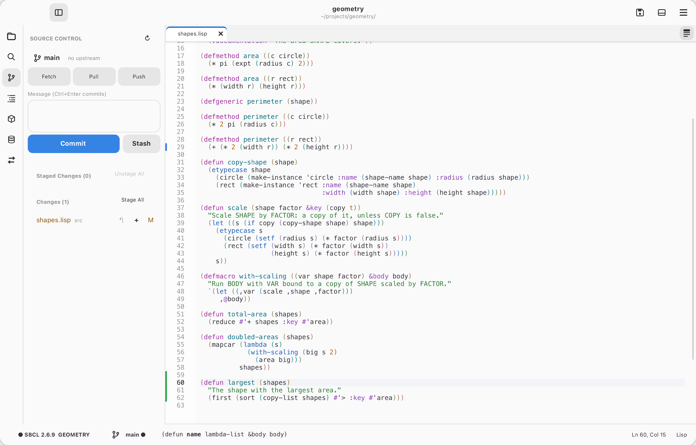

# Git

<picture>
  <source media="(prefers-color-scheme: dark)" srcset="../gallery/dark/git.png">
  
</picture>

In a Git repository:

- The gutter marks lines added (green), changed (blue) and deleted (red
  wedge) since the last commit, including unsaved edits. Click a mark to see
  what was there and revert it.
- The explorer colors changed files (and dots their folders); the status bar
  shows the branch (● when there are changes).
- The Source Control page (`Ctrl+Shift+G`, `C-x v v`, or the branch icon)
  lists staged and unstaged changes: click one for its diff; `+` stages, `−`
  unstages, `↶` discards (after asking; new files go to the Trash). Write a
  message and Commit (`Ctrl+Enter`); with nothing staged it offers to stage
  everything. A folder that isn't a repository gets an Initialize button.

To stage part of a file: click a change's mark in the gutter and choose
Stage, or put the cursor in it and `M-x git-stage-change` (`C-x v S`; staged
from the saved file). A file's diff opened from Source Control is live: `s`
stages the change at the cursor, `u` unstages it (in the staged diff), `x`
discards it (asking first), `n`/`p` move between changes and `g` refreshes.

Merge conflicts: `M-x merge-branch` (`C-x v m`) merges another branch in.
Conflicted files are listed first on the Source Control page, with a banner
offering Abort and Commit (Continue for a rebase), and the merge message
ready. In a conflicted file each conflict is colored (yours green, theirs
blue) with Accept Current / Accept Incoming / Accept Both buttons on its
first line; the same are in the right-click menu under Git, and in Emacs
`C-c ^ u` / `C-c ^ l` / `C-c ^ a`, with `C-c ^ n` / `C-c ^ p` to move
between conflicts. Save, stage the file (`+`) to mark it resolved, and
Commit.

History opens on the panel's History page, newest first (Show more loads
older ones); click a commit to see it. Blame annotates each run of lines in
the gutter with its commit, author and age (your unsaved edits show as not
committed yet); click an annotation for the commit. Blame, File History and
the others are also in the editor's right-click menu under Git. Stashes are
listed at the bottom of the Source Control page with Apply, Pop and Drop;
the Stash button next to Commit makes one (new files included).

The page's top row shows the branch (click it to switch or make one) and
how many commits there are to push (↑) and pull (↓), with Fetch, Pull and
Push. The first push of a branch sets up its upstream (on `origin`). Pull
only fast-forwards by default; set `*git-pull-mode*` to `:merge` or
`:rebase` to combine diverged work. Cadre never asks for passwords: fetch,
pull and push use your credential helper or ssh-agent, and fail with
git's message if those can't supply one.

| Action | Standard (⌘ on macOS) | Emacs |
| --- | --- | --- |
| Switch / new / delete branch | `M-x switch-branch` / `create-branch` / `delete-branch` | `C-x v b s` / `C-x v b c` / `C-x v b d` |
| Fetch / pull / push | `M-x fetch-changes` / `pull-changes` / `push-changes` | `C-x v f` / `C-x v +` / `C-x v P` |
| Project / file history | `M-x show-history` / `show-file-history` | `C-x v L` / `C-x v l` |
| Blame in the gutter (toggle) | `M-x toggle-blame` | `C-x v g` |
| Stash / apply / pop / drop | `M-x stash-changes` / `apply-stash` / `pop-stash` / `drop-stash` | `C-x v z z` / `C-x v z a` / `C-x v z p` / `C-x v z d` |
| Next / previous change | `Alt+F5` / `Alt+Shift+F5` | `C-x v ]` / `C-x v [` |
| Revert the change at the cursor | `M-x git-revert-change` | `C-x v n` |
| Diff this file | `M-x git-diff-file` | `C-x v =` |
| Stage this file | `M-x git-stage-file` | `C-x v s` |
