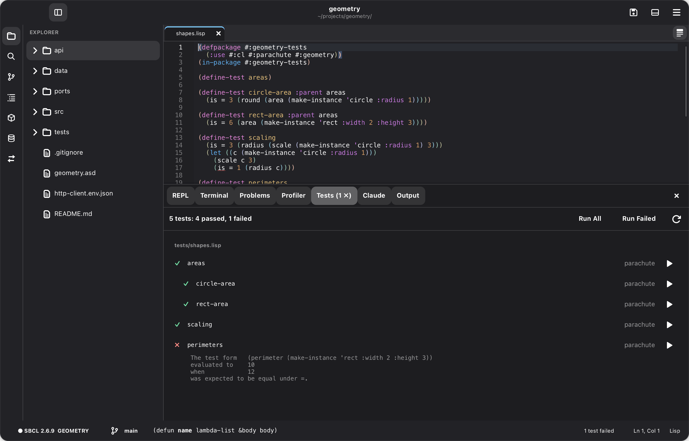

# Projects, tests and running programs

## The Project page

The sidebar's Project page (the box icon) lists the folder's ASDF systems: load,
reload with compiler notes, test, and open their files. When the folder is a
Racket package or a Clojure project, the page shows that too:
- **Racket** (`info.rkt`): the dependencies, with Install for any not yet
  installed (`raco pkg install`); the modules, each with Run and Test; and
  Test, Make, Install for This Machine (`raco pkg install --link`) and Build
  Docs, which makes the package's own docs: what its modules provide, with
  their definitions' headers and the comments above them, read from the
  source without running it.
- **Clojure** (`deps.edn`, `project.clj` or `bb.edn`): the REPL, with Jack
  In or Restart; the aliases (Leiningen's profiles) to start it with; the
  dependencies; the namespaces, each with Load and Test; Run All Tests; and
  Build Docs, which makes the project's own docs from its namespaces'
  docstrings (through its REPL).
- A project's docs are kept apart from the language's, and Look Up in Docs
  searches them first.
- Saving `info.rkt` or a Clojure project file says when there's something
  to install. **Load New Dependencies** adds a `deps.edn` project's new
  libraries to its running REPL without a restart (Clojure 1.12's
  `sync-deps`). Leiningen and Babashka projects download them, then restart.
  Install Project Dependencies does the same from the command palette.

## Libraries

**Libraries** (Project › Libraries…, or the `+` on the Project page) shows what
the project's system depends on (its `.asd`'s `:depends-on`) and searches
the systems Quicklisp offers. **Add** puts one in the `.asd`, keeping its
layout and comments, and loads it with Quicklisp in the REPL, which downloads
it first if it must; **Load** only loads it; **Remove** takes it out of the
`.asd`. It needs Quicklisp in the Lisp.

## New projects

**New Project…** (in the main menu, or `M-x new-project`) makes a Common Lisp
project, a Racket package or a Clojure project. It asks for:
- the project's name, description and author
- where to put it
- whether it's a library or an application
- the test framework (Parachute or FiveAM)
- the license (MIT, BSD 2-Clause or none)
- whether to start a Git repository

It then opens the new project at `src/main.lisp`. It writes:

| File | What it is |
| --- | --- |
| `NAME.asd` | The system, and `NAME/tests` hooked to ASDF's `test-op`, so `(asdf:test-system :NAME)` runs the tests. An application also gets `:build-operation`, `:build-pathname` and `:entry-point`. |
| `src/package.lisp`, `src/main.lisp` | The package, and a `hello` function to start from (an application also gets `main`) |
| `tests/main.lisp` | A test of `hello` |
| `Makefile` | `make load`, `make test` (exits 1 if a test fails), `make clean`, and for an application `make build` (writes `bin/NAME`). It uses Quicklisp, loaded from your Lisp's init file, to fetch dependencies. |
| `README.md`, `.gitignore`, `LICENSE` | |

**Build Project** (`Ctrl+Shift+B`, Emacs `C-x p c`, or the main menu) builds
the open project's program:
- **How:** with `make build` if the Makefile has a build target. Otherwise, if
  one of its systems has a `:build-operation`, it runs `(asdf:make …)` in a new
  Lisp, because saving the image ends the Lisp that does it.
- **First:** it saves the project's changed files.
- **While it runs:** its output streams to the Output page.
- **When it ends:** the status bar names the program, its size and how long
  the build took.
- `M-x stop-build` stops a build.

**Run Tests** (`Ctrl+; A`, Emacs `C-x p t`) runs `(asdf:test-system …)` in the
connected Lisp's REPL, after saving the project's files:
- **What it loads first:** with Quicklisp, it loads the system and its
  `name/…` test systems, so missing dependencies are fetched.
- **Results:** they print in the REPL, and an error in a test opens the
  debugger.
- **Which system:** the project's only main system, or the one you choose,
  with the last one you tested listed first.

**Run Tests in a New Lisp** (`Ctrl+; N`, `C-x p T`) runs `make test`, or
`asdf:test-system` in a fresh Lisp:
- **Why use it:** nothing left over in your session can make the tests pass.
- **Results:** output goes to the Output page, and the status bar says whether
  the tests passed. A new project's `make test` exits 1 when a test fails;
  plain `asdf:test-system` doesn't say whether tests failed.

## The Tests page

**Tests** (Project › Test Explorer) lists the project's tests, found in its
files, by file: Common Lisp's parachute and FiveAM tests, Clojure's
`deftest`s (run through cider-nrepl, which Cadre's REPL has) and Racket's
rackunit `test-case`s (run with `raco test`, a whole file at a time). **Run All** runs them, **Run
Failed** the ones that failed, and ▶ one test (with the tests inside it).
Each run saves the project's files and loads the code again first (its
systems, or the Clojure files), so it tests the code as it is now. A failed test shows its failed checks; click a
test to go to it. In a test file, Debug › Run This Test (right-click) runs the
test the cursor is in.

## Running the project's program

▶, Build Project and the Project page act on the project of the file you're
in: the nearest folder above it with an `.asd`, `info.rkt`, `deps.edn`,
`project.clj` or `bb.edn`, within the open folder. So with a folder of
several projects open, switching to a file in another project switches them
to that project.

When a project's `.asd` has an `:entry-point` (as New Project's
application kinds write), a **▶** button appears in the header bar. **Run
App** (the button, `Ctrl+F5`, Emacs `C-x p r`, or the main menu) saves the
project's files, loads its system in the connected Lisp (recompiling what
changed), and calls the entry point:
- **A GTK app** (its system depends on `gtk4`) runs as Run GTK App runs it,
  below.
- **Any other program** runs in the REPL, and its output appears there. When
  it reads standard input (`read-line`, `read`), the REPL waits for a line:
  type it and press RET.
- **A raylib game** (its system depends on [`raylib`](https://github.com/crazymevt/raylib), and its entry point
  starts the game with `rl:run`) runs on the Lisp's first thread while the
  REPL stays free for redefining its functions. The app runs until the
  game's window closes.
- **A Racket package** (or folder of Racket code) gets ▶ when a top-level
  module has a `main` submodule (`main.rkt` first). It runs in the Racket
  REPL, as Run File does, and the REPL takes the lines it reads.
- **A Clojure project** gets ▶ when it has a main namespace: `:main` in
  `project.clj`, an alias's `:main-opts ["-m" "app.core"]` in `deps.edn`,
  or a namespace under `src/` that defines `-main`. ▶ starts the REPL if
  needed, loads the namespace and calls its `-main` in the Clojure REPL. If
  the file doesn't load, its error is in Problems and `-main` isn't called.
  The status bar says what it returned.

While the app runs, the button turns into **■**: **Stop App**
(`Ctrl+Shift+F5`, `C-x p k`) quits a GTK app, ends a raylib game
(`rl:stop`), or aborts the REPL's evaluation, even while it waits for input.

## GTK applications

On macOS, GTK must run on a process's first thread, but the REPL runs on
another one. **Run GTK App** (the ▶ button for a gtk4 project, or the main
menu) handles this:
- **Starting:** it has the first thread of the Lisp Cadre started (it reads
  that Lisp's standard input) load the project's system and call its entry
  point. That's the `:entry-point` in the `.asd`, or a function you name once
  per project. The REPL and the rest of Cadre stay connected.
- **Evaluating:** while the app runs, what you evaluate (in the REPL, or a form
  or region in a file) runs on the GTK thread, wrapped in
  `(glib:in-main-thread (:wait t) …)`. The status bar shows `· GTK`, and
  `M-x toggle-gtk-thread-evaluation` turns this off. `in-package` and
  compiling definitions aren't wrapped.
- **Errors in GTK callbacks** open the debugger, and the GTK thread waits while
  it's open. Its Abort restart returns from the callback, and the app keeps
  running.
- **Changing it:** handlers connected by symbol pick up redefinitions at once.
- **Stopping:** when the last window closes, Cadre notices, and Run GTK App
  starts it again. **Stop GTK App** (■, `Ctrl+Shift+F5`, `C-x p k`) quits the
  GTK application. The SBCL process Cadre started stays connected as the
  project's REPL, so you can run the app again without losing that session.
  On macOS its Dock icon stays while the process is alive, even when the GTK
  window is closed. **Disconnect Lisp** (`M-x disconnect`) ends that process
  and its REPL session; starting or running the project again starts a fresh
  Lisp.

It needs a Lisp that Cadre started (`M-x lisp`), not one it connected to.
New Project's **GTK application** kind starts a project ready for this:
- it depends on `gtk4`, with a window and an entry point to start from;
- its Makefile has `make run`, `make dev` (a Swank server on port 4005 and the
  app, for another editor's REPL) and `make build` (an executable, with
  `gtk4:save-executable`).
