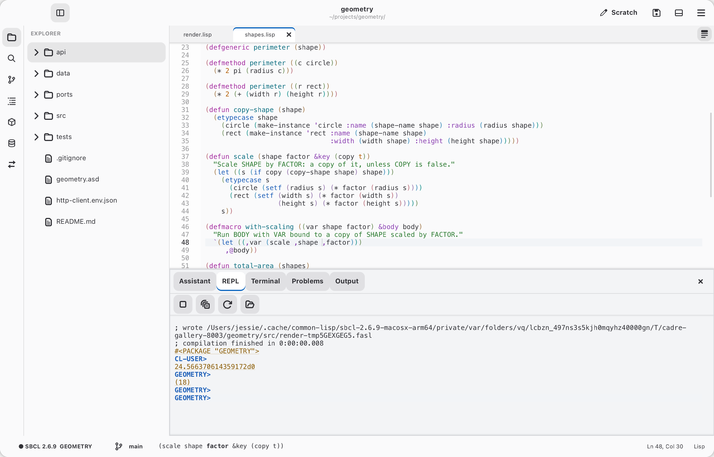

# Settings, themes and configuration

*Settings…* in the menu (`Ctrl+,`, or `M-x settings` / `M-x customize`)
lists every option by category, with search. Changes apply at once where
they can and are saved to `~/.config/cadre/settings.sexp`; each row has a
button that puts the option back to its default. Choices made there are
applied after `init.lisp`, so they win.

*Color Theme…* (`M-x choose-theme`) picks a theme: Cadre Light and Dark,
Solarized Light and Dark, and High Contrast Dark. Cadre keeps a preferred
light theme and a preferred dark one and follows the system's style, unless
*Color scheme* is set to Light or Dark (`M-x toggle-dark-style` switches).
Write your own with `define-theme` in `~/.config/cadre/themes/*.lisp`:

```lisp
(cadre-ui::define-theme my-dark (:dark t :background "#1b1b1b" :foreground "#d0d0d0")
  (:comment :foreground "#6a9955" :style :italic)
  (:string :foreground "#ce9178"))     ; faces left out come from Cadre Dark
```

<table>
  <tr>
    <td width="50%"><br>Cadre Dark</td>
    <td width="50%"><br>Cadre Light</td>
  </tr>
</table>

Open files that change on disk reload by themselves when they have no
unsaved changes; otherwise a bar offers *Reload*, *Keep Mine* or *Compare*
(an inline diff of the version on disk).

## Configuration

`~/.config/cadre/init.lisp` is loaded at startup in the `cadre-user` package:

```lisp
(setf *editor-font* "JetBrains Mono 13pt")
(bind-key *standard-global-keymap* "C-k C-s" 'save-all)
(define-indentation my-with-macro 1)   ; indent like WHEN
(define-command insert-date ()
  "Insert today's date."
  (multiple-value-bind (s m h day month year) (get-decoded-time)
    (declare (ignore s m h))
    (buffer-insert (current-buffer) (format nil "~d-~2,'0d-~2,'0d" year month day))))
```

Cadre writes its own choices (keybindings, layout, last folder) to
`~/.config/cadre/settings.sexp`.
